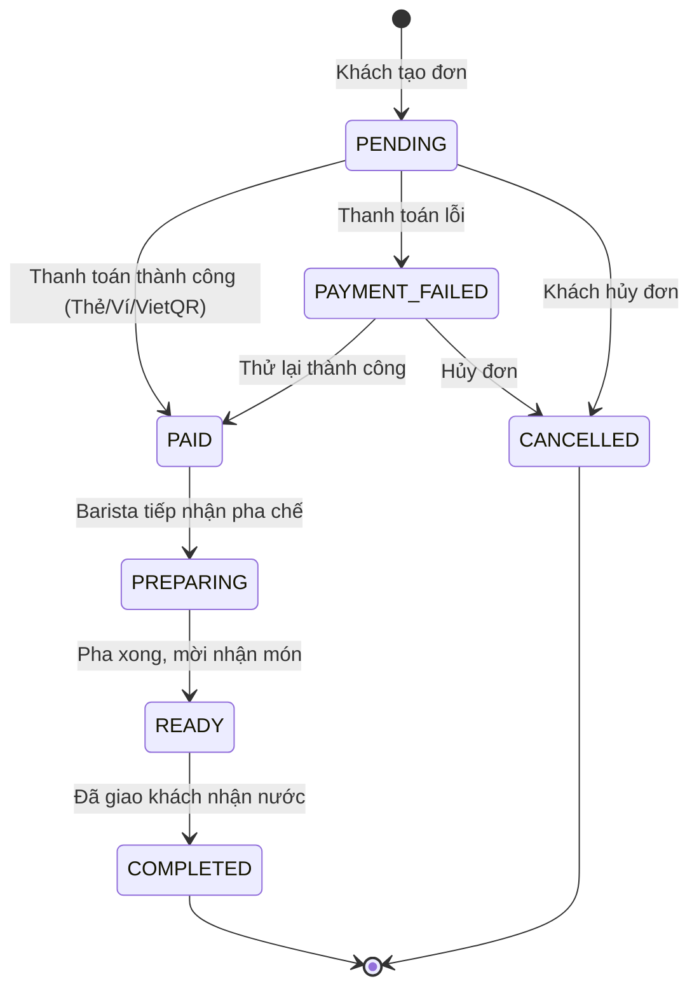

# ☕ BrewLite — Hệ Thống Đặt Hàng & Thanh Toán Cà Phê Không Dùng Tiền Mặt
## (Cashless Coffee Ordering & Kitchen Management Platform — VER 1.0)

> **Cơ sở đào tạo**: TRƯỜNG ĐẠI HỌC SÀI GÒN — KHOA CÔNG NGHỆ THÔNG TIN  
> **Môn học**: Công Nghệ Phần Mềm (Software Engineering) — Học kỳ I, Năm học 2026–2027  
> **Kiến trúc hệ thống**: Monorepo NestJS 10 (Backend REST API) + Next.js 14 App Router (Frontend Web App) + PostgreSQL 16 + Prisma ORM 5.x + Docker Compose  
> **Mô hình phát triển**: Agile Scrum kết hợp Order State Machine & Optimistic Concurrency Control (OCC)  
> **Repository GitHub**: [https://github.com/gphuoc-216/BrewLiteProject](https://github.com/gphuoc-216/BrewLiteProject)  
> **Nhánh tích hợp chính**: `develop` | **Nhánh chức năng**: 7 Feature Branches (`feat/p1` đến `feature/p7`)  

---

## 🎯 1. TỔNG QUAN DỰ ÁN & PRODUCT VISION (MỤC 3 ĐỀ BÀI)

### 1.1 Product Vision
> *"BrewLite giúp khách hàng đặt và thanh toán đồ uống không dùng tiền mặt chỉ trong vài chạm, giảm thời gian xếp hàng và nhận đơn nhanh tại quầy."*

### 1.2 Các Bên Liên Quan (Stakeholders)
- **Khách hàng**: Đặt đồ uống, chọn size/topping, thanh toán không tiền mặt (VietQR/MBBank Simulator) và theo dõi lịch sử đơn.
- **Nhân viên quầy / Barista**: Tiếp nhận đơn và cập nhật trạng thái pha chế thời gian thực trên Bảng Kanban (`/staff`).
- **Quản lý cửa hàng / Product Owner**: Xác định yêu cầu, ưu tiên Product Backlog và nghiệm thu Increment sau mỗi Sprint.
- **Nhóm phát triển (Development Team)**: 7 thành viên phân tích, thiết kế, lập trình, kiểm thử và bàn giao hệ thống.
- **Đơn vị thanh toán**: Cổng thanh toán mô phỏng (Mock Payment Gateway & MBBank Webhook).

---

## 🔄 2. QUY TRÌNH AGILE SCRUM & KẾ HOẠCH 3 SPRINT (MỤC 2 ĐỀ BÀI)

### 2.1 Thành Viên Nhóm Phát Triển (Development Team)
Nhóm gồm 7 thành viên đảm nhận 7 gói công việc độc lập trên 7 nhánh tính năng riêng:
1. **Võ Đức Hoàng Vinh** (`V9vinh`): Layout nền tảng, Catalog Menu thực đơn số, tìm kiếm debounce, badge tạm hết hàng (`feat/p1-menu-page`).
2. **Hồ Hoàng Anh** (`anhho7303-source`): Modal tùy chọn nhanh, chi tiết món `/products/:id`, Size S/M/L, đường đá topping, đánh giá (`feat/p2-product-details`).
3. **Dương Thành Phát** (`phatthanh-kiko`): Quản lý giỏ hàng Zustand persist, gộp biến thể, voucher thông minh, điểm loyalty (`feat/p3-cart-store`).
4. **Quách Thanh Phú** (`quachthanhphuu-maker`): Xác thực tài khoản, màn hình Checkout, mã VietQR Canvas nội bộ, mô phỏng MBBank (`feat/p4-checkout-history`).
5. **Đặng Lương Thế Anh** (`dangluongtheanh-max`): CSDL PostgreSQL, Prisma ORM, API `GET /products` đối chiếu định lượng nguyên liệu (`feat/p5-api-products`).
6. **Nguyễn Hoàng Anh** (`hanhdevsgu`): Quản lý kho nguyên liệu, API `POST /orders`, Auth JWT/Bcrypt, Mock Payment Gateway (`feat/p6-payment-ingredients-orders`).
7. **Hoàng Trần Gia Phước** (`gphuoc-216`): Order State Machine, Idempotency-Key, Optimistic Locking (OCC), Docker Compose (`feature/p7-backend`).

### 2.2 Kế Hoạch 3 Sprint Cho BrewLite
| Sprint | Thời Lượng | Mục Tiêu Sprint (Sprint Goal) | Nhiệm Vụ Hoàn Thành | Sản Phẩm Tăng Dần (Increment) |
|:---:|:---:|:---|:---|:---|
| **Sprint 1** | 14/10 – 20/10 | Nền tảng & hiển thị menu | Task 1, Task 2, Task 3, Task 4 | Khởi tạo Monorepo, CSDL PostgreSQL, API Products, Giao diện Menu & Modal chi tiết món chọn size/topping. |
| **Sprint 2** | 21/10 – 27/10 | Giỏ hàng, đặt đơn & đăng nhập | Task 5, Task 6, Task 7 | Giỏ hàng Zustand persist, Voucher, Điểm loyalty, API POST /orders, Auth JWT / Bcrypt. |
| **Sprint 3** | 28/10 – 02/11 | Thanh toán, bàn giao & nghiệp vụ nâng cao | Task 8, Task 9, Task 10 | Thanh toán VietQR / MBBank, Lịch sử đơn, Order State Machine, OCC chống oversell kho, Docker Compose & 48 unit tests. |

### 2.3 Quy Tắc Git Flow & Lịch Sử Merge Code (Git Branching Strategy)
```
feat/p1-menu-page ──────────► (PR #3) ──┐
feat/p2-product-details ────► (PR #4) ──┤
feat/p3-cart-store ─────────► (PR #2) ──┤
feat/p4-checkout-history ───► (PR) ─────┼──► develop (Nhánh tích hợp chính)
feat/p5-api-products ───────► (PR #1) ──┤
feat/p6-payment-ingredients ► (PR) ─────┤
feature/p7-backend ─────────► (PR) ─────┘
```
1. **Phân nhánh độc lập**: Mỗi thành viên code trên 1 nhánh tính năng riêng (`feat/p1` đến `feature/p7`).
2. **Quy trình tích hợp**: Các tính năng được phát triển trên từng nhánh riêng và tích hợp vào nhánh chính `develop` qua Pull Request sau khi hoàn tất kiểm thử và review.

---

## 📋 3. PRODUCT BACKLOG: BẢNG 10 TASK CHUẨN ĐỀ BÀI (10 ĐIỂM)

Bảng đối chiếu 1-1 giữa 10 Task trong đề bài PDF với phân công 7 thành viên và 7 feature branch:

| Task | Tên Nhiệm Vụ (PDF) | Điểm | Thành Viên Phụ Trách | Nhánh Git | Tiêu Chí Chấp Nhận Chính (Acceptance Criteria) |
|:---:|:---|:---:|:---|:---:|:---|
| **Task 1** | Khởi tạo dự án & cấu trúc | 1đ | Võ Đức Hoàng Vinh (FE)<br>Đặng Lương Thế Anh (BE) | `feat/p1-menu-page`<br>`feat/p5-api-products` | Monorepo Next.js 14 + NestJS 10, PostgreSQL Prisma, Docker Compose, .env.example, README, build 0 lỗi. |
| **Task 2** | API danh sách sản phẩm | 1đ | Đặng Lương Thế Anh | `feat/p5-api-products` | `GET /products` trả về JSON menu (id, tên, giá, ảnh); tự động tính tồn kho nguyên liệu ra cờ `isOutOfStock`. |
| **Task 3** | Trang Menu (Frontend) | 1đ | Võ Đức Hoàng Vinh | `feat/p1-menu-page` | Next.js gọi `/products`, render lưới sản phẩm responsive, search debounce, loading/empty state, badge `⛔ Tạm hết hàng`. |
| **Task 4** | Chi tiết & tùy chọn sản phẩm | 1đ | Hồ Hoàng Anh | `feat/p2-product-details` | Modal Quick Select & `/products/:id`, chọn Size S/M/L (tự vô hiệu hóa size hết), đường/đá/topping có ảnh, gửi đánh giá sao. |
| **Task 5** | Giỏ hàng (Cart Store) | 1đ | Dương Thành Phát | `feat/p3-cart-store` | Zustand Store persist, gộp món cùng biến thể, trang `/cart`, voucher thông minh, tích lũy & dùng điểm (1đ = 100đ). |
| **Task 6** | API tạo đơn hàng | 1đ | Nguyễn Hoàng Anh | `feat/p6-payment-ingredients-orders` | `POST /orders` nhận giỏ hàng, validate `class-validator`, lưu đơn `PENDING`, tự động trừ kho nguyên liệu. |
| **Task 7** | Đăng ký / Đăng nhập (JWT) | 1đ | Quách Thanh Phú (FE)<br>Nguyễn Hoàng Anh (BE) | `feat/p4-checkout-history`<br>`feat/p6-payment-ingredients-orders` | `POST /auth/register`, `/auth/login`, băm Bcrypt 1 chiều, Access/Refresh Token, `JwtAuthGuard` bảo vệ route. |
| **Task 8** | Thanh toán không tiền mặt | 1đ | Quách Thanh Phú (FE)<br>Nguyễn Hoàng Anh (BE) | `feat/p4-checkout-history`<br>`feat/p6-payment-ingredients-orders` | Mock Payment (Ví/Thẻ), `POST /payments`, chuyển `PAID` / `PAYMENT_FAILED`, vẽ mã VietQR Canvas nội bộ, MBBank simulator. |
| **Task 9** | Xác nhận, lịch sử & bàn giao | 1đ | Quách Thanh Phú (FE)<br>Hoàng Trần Gia Phước (BE) | `feat/p4-checkout-history`<br>`feature/p7-backend` | Màn hình xác nhận đơn, `GET /orders/me` (lịch sử đơn); Docker Compose 3 container hoàn chỉnh; demo end-to-end. |
| **Task 10** | Nghiệp vụ backend chuyên sâu | 1đ | Nguyễn Hoàng Anh (Kho & Voucher)<br>Hoàng Trần Gia Phước (State & OCC) | `feat/p6-payment-ingredients-orders`<br>`feature/p7-backend` | Order State Machine chống gian lận, Idempotency-Key chống trừ trùng, OCC khóa lạc quan tồn kho, 48 tests Jest pass. |

---

## ⚙️ 4. TASK 10: NGHIỆP VỤ BACKEND CHUYÊN SÂU & STATE MACHINE (MỤC 9 ĐỀ BÀI)

### 4.1 Sơ Đồ Máy Trạng Thái Đơn Hàng (Order State Machine)

- **Hàm chặn chuyển trạng thái sai**: `assertTransition(fromStatus, toStatus)` sẽ ném `BadRequestException` nếu cố tình nhảy cóc trạng thái (VD: `PENDING` nhảy thẳng lên `COMPLETED` sẽ bị chặn ngay lập tức).
- **Trạng thái kết thúc**: `COMPLETED` và `CANCELLED` là trạng thái đóng, không được phép chuyển tiếp thêm.

### 4.2 Bốn Nghiệp Vụ Backend Cốt Lõi
1. **Order State Machine**: Quản lý vòng đời đơn hàng nghiêm ngặt, ghi audit log `order_status_histories`.
2. **Thanh toán Idempotent**: Sử dụng `Idempotency-Key` duy nhất trên mỗi giao dịch. Nếu gửi lặp lại cùng một request, hệ thống trả về kết quả đã cache mà không trừ tiền hay tạo đơn lần 2.
3. **Kiểm soát tồn kho khi đặt đồng thời (OCC)**: Kết hợp PostgreSQL Transaction + Optimistic Locking (cột `version` trên `Ingredient`). Tự động retry tối đa 3 lần, giải quyết triệt để bài toán overselling khi 10 khách cùng bấm đặt 1 món.
4. **Khuyến mãi & Điểm thưởng Loyalty**: Áp dụng mã voucher hợp lệ và tự động tích lũy điểm thưởng cho khách hàng sau khi đơn chuyển sang `PAID` (1 điểm = 100đ).

---

## 🚀 5. HƯỚNG DẪN CÀI ĐẶT & KHỞI CHẠY HỆ THỐNG (TỪ A ĐẾN Z)

### 5.1 Yêu Cầu Tiên Quyết (Prerequisites)
- **Node.js**: Phiên bản `18.x` hoặc `20.x LTS` (Khuyến nghị `Node.js 20.x`). Kiểm tra: `node -v`.
- **NPM**: Phiên bản `9.x` hoặc `10.x`. Kiểm tra: `npm -v`.
- **Git**: Đã cài đặt trên máy. Kiểm tra: `git --version`.
- **Docker Desktop**: *(Khuyên dùng)* để chạy toàn bộ hệ thống bằng 1 câu lệnh.

---

### 5.2 Cách 1: Khởi Chạy Nhanh Bằng Docker Compose (Khuyên Dùng)

Tại thư mục gốc dự án, chạy lệnh:
```bash
docker compose up -d --build
```
> Hệ thống sẽ tự động:
> 1. Dựng CSDL PostgreSQL 16 Alpine (`brewlite_postgres`).
> 2. Build multi-stage image Backend NestJS (`brewlite_backend`), tự migrate CSDL.
> 3. Build production Frontend Next.js 14 (`brewlite_frontend`).
> 4. Gắn healthcheck kiểm tra trạng thái sẵn sàng.

#### Nạp dữ liệu hạt giống ban đầu (Seed Database):
```bash
docker exec -it brewlite_backend npm run seed
```

#### Dừng hệ thống:
```bash
docker compose down
```

---

### 5.3 Cách 2: Khởi Chạy Thủ Công Từng Phần (Local Development)

#### Bước 1: Khởi động CSDL PostgreSQL
```bash
docker run --name brewlite_postgres -e POSTGRES_USER=postgres -e POSTGRES_PASSWORD=postgrespassword -e POSTGRES_DB=brewlite_db -p 5432:5432 -d postgres:16-alpine
```

#### Bước 2: Cấu hình và chạy Backend (NestJS)
```powershell
cd backend
copy .env.example .env
npm install
npx prisma generate
npx prisma migrate deploy
npm run seed              # Nạp danh mục món, nguyên liệu kho và tài khoản mẫu
npm run start:dev
```
> ✅ Backend API: `http://localhost:3001` | 📑 Swagger API Docs: `http://localhost:3001/api/docs`

#### Bước 3: Cấu hình và chạy Frontend (Next.js)
Mở cửa sổ Terminal thứ hai:
```powershell
cd frontend
copy .env.example .env.local
npm install
npm run dev
```
> ✅ Giao diện Khách hàng: `http://localhost:3000`

---

### 5.4 Cách 3: Demo Quét Mã QR Bằng Điện Thoại Thật (Mobile QR Payment)
```powershell
npm run phone
# Hoặc:
node scripts/tunnel.js
```
> Terminal in **Mã QR to rõ ngay trên console** và một đường link HTTPS công khai. Dùng camera điện thoại quét để mở ứng dụng MBBank Simulator!

---

### 5.5 Cách 4: Chạy Kiểm Thử Tự Động (Automated Testing)

#### 1. Chạy 6 Test Suites Unit Tests Backend (48 unit tests Jest pass 100%):
```powershell
npm run test
# Hoặc:
npm --prefix backend test
```
*Kiểm thử toàn diện: State Machine, Idempotency-Key, Loyalty, Optimistic Locking tồn kho, Case-insensitive category.*

#### 2. Kiểm thử xung đột đồng thời (Race Condition Test):
```powershell
node scripts/test-race-condition.js
```
*Chứng minh OCC xử lý 10 giao dịch đồng thời không gây bán lố nguyên liệu.*

#### 3. Kiểm tra tính hợp lệ Build Production:
```powershell
npm run build:backend
npm run build:frontend
```

---

## 🔑 6. TÀI KHOẢN MẪU ĐỂ NGHIỆM THU

Dữ liệu tài khoản đã nạp sẵn trong lệnh `npm run seed`:

| Vai Trò | Tên Đăng Nhập | Mật Khẩu | Đường Dẫn Trải Nghiệm | Chức Năng Kiểm Thử |
|:---|:---|:---:|:---:|:---|
| **Khách Hàng (Customer)** | `customer1` | `123456` | `/login` ➔ `/` | Đặt món, chọn size/topping, áp mã voucher, dùng điểm tích lũy, quét mã VietQR, thanh toán tự động, đánh giá sao. |
| **Nhân Viên Pha Chế (Staff)** | `barista1` | `123456` | `/staff` | **Bảng Kanban Barista (FIFO):** Tiếp nhận đơn từ "Đã thanh toán" ➔ "Đang pha chế" ➔ "Sẵn sàng" ➔ "Hoàn thành". |
| **Quản Trị Viên (Admin)** | `admin` | `admin123` | `/admin` | **Dashboard Quản Trị:** Thống kê doanh thu, cảnh báo tồn kho nguyên liệu chạm ngưỡng đỏ, tạo phiếu nhập kho. |

---

## 📱 7. CÁC ĐƯỜNG DẪN TRỰC TIẾP TRÌNH DIỄN ĐỒ ÁN

- **Cổng Đặt Món & Thực Đơn Khách Hàng**: [http://localhost:3000](http://localhost:3000)
- **Giỏ Hàng & Cổng Thanh Toán VietQR**: [http://localhost:3000/checkout](http://localhost:3000/checkout)
- **Bảng Kanban Quầy Pha Chế Barista**: [http://localhost:3000/staff](http://localhost:3000/staff)
- **Dashboard Báo Cáo Doanh Thu & Quản Trị**: [http://localhost:3000/admin](http://localhost:3000/admin)
- **Ứng Dụng Giả Lập MBBank Mobile (Trên PC)**: [http://localhost:3000/mbbank](http://localhost:3000/mbbank)
- **Tài Liệu API Chuẩn OpenAPI / Swagger**: [http://localhost:3001/api/docs](http://localhost:3001/api/docs)

---

## 📋 8. DEFINITION OF DONE (MỤC 10 ĐỀ BÀI)
- [x] Code chạy ổn định, không có lỗi build (`npm run build:backend` & `npm run build:frontend` pass 100%).
- [x] Đầy đủ commit trên Git với conventional commit (`feat`, `fix`, `docs`, `refactor`).
- [x] Toàn bộ API có validation (`class-validator`), UI có trạng thái loading/error boundary/skeleton.
- [x] Có hướng dẫn cài đặt từ A đến Z trong file README.md này.
- [x] Đạt 48 unit tests pass và kịch bản race condition test thành công.

---

## 📚 9. TÀI LIỆU CHUYÊN SÂU DỰ ÁN
- **Bảng Phân Công Công Việc 7 Thành Viên**: [docs/TASK-ALLOCATION.md](./docs/TASK-ALLOCATION.md)
- **Tài Liệu Đặc Tả Kỹ Thuật & 81 Hàm Nguyên Tử**: [docs/01-analysis-spec.md](./docs/01-analysis-spec.md)
- **Kế Hoạch Triển Khai Chi Tiết**: [docs/02-implementation-plan.md](./docs/02-implementation-plan.md)
