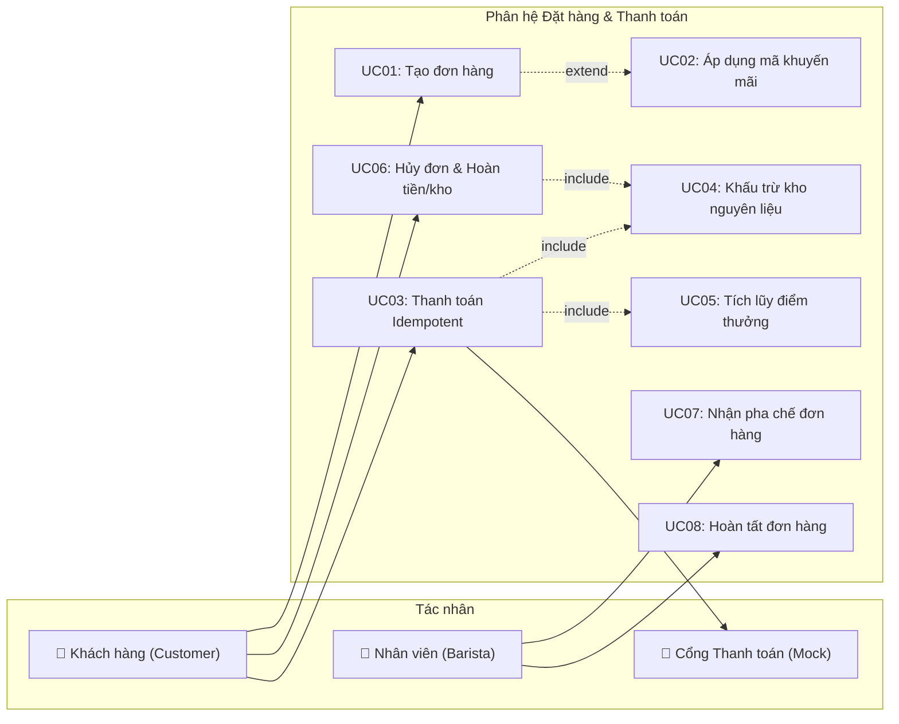
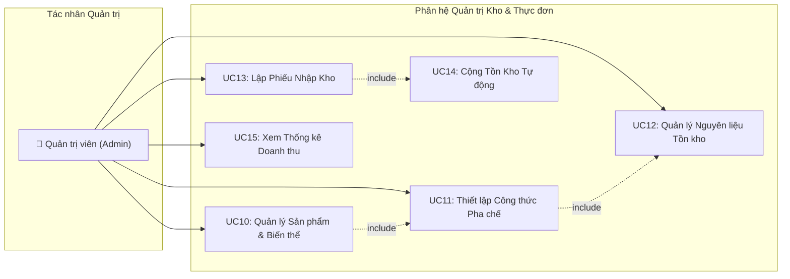
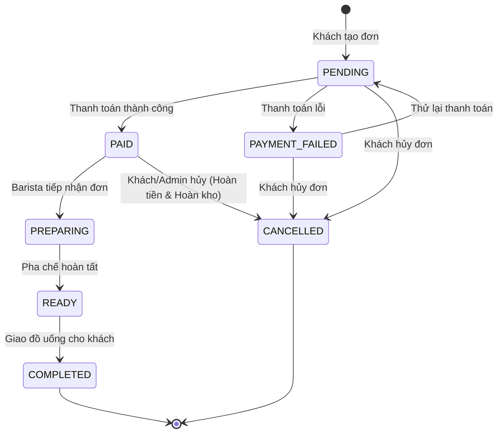
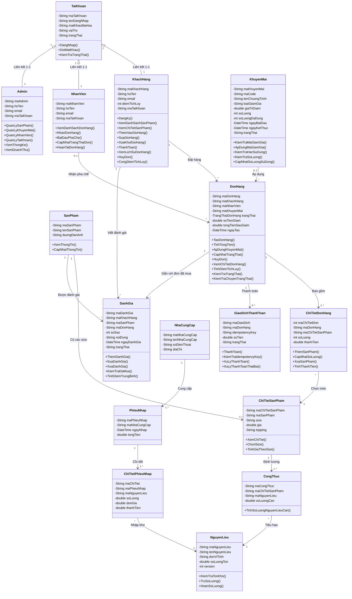
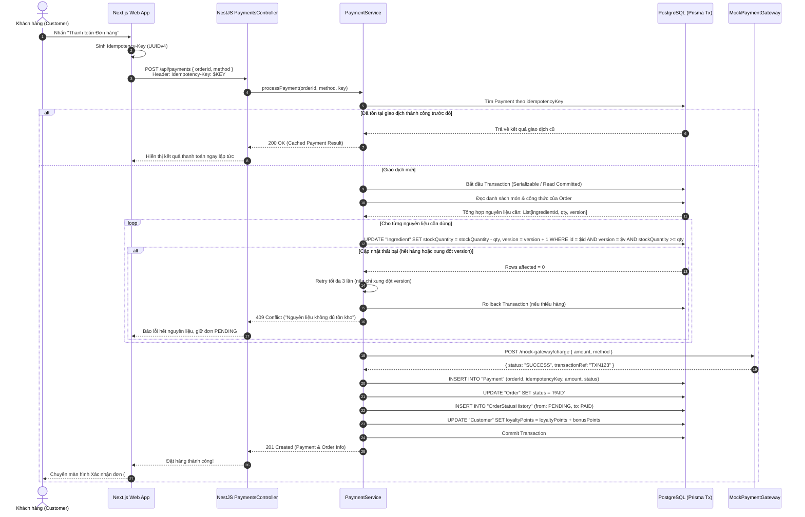
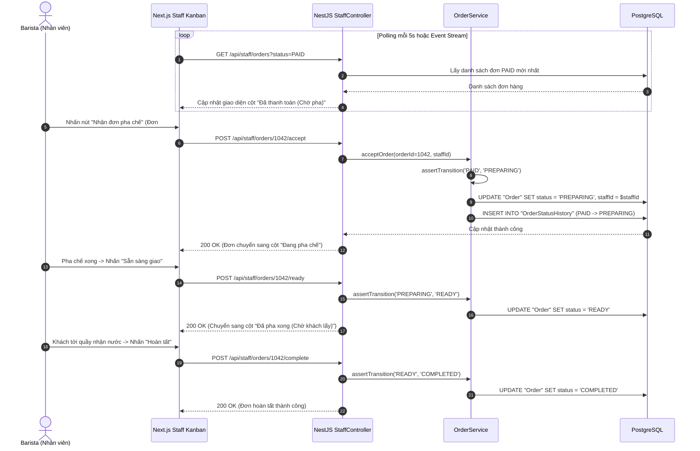

# Tài Liệu Đặc Tả Kỹ Thuật Hệ Thống BrewLite (Analysis & Specification)

> **Dự án**: BrewLite — Hệ thống đặt và thanh toán cà phê không dùng tiền mặt (Cashless Coffee Platform)  
> **Kiến trúc hệ thống**: Monorepo NestJS (Backend API) + Next.js (Frontend Web App) + PostgreSQL  
> **Phiên bản tài liệu**: v1.0.0 | **Ngày phát hành**: 13/10/2026  
> **Nguồn đặc tả**: Tài liệu phân tích yêu cầu nghiệp vụ và sơ đồ thiết kế hệ thống chuỗi BrewLite.

---

## 1. Tổng quan & Tầm nhìn Dự án (Product Overview)

### 1.1 Tầm nhìn Sản phẩm (Product Vision)
> *"BrewLite giúp khách hàng đặt và thanh toán đồ uống không dùng tiền mặt chỉ trong vài chạm, loại bỏ hoàn toàn việc xếp hàng chờ thanh toán tại quầy, đồng thời cung cấp công cụ vận hành số hóa khép kín từ quầy pha chế (Barista) đến kiểm soát kho nguyên liệu và quản trị chuỗi cho doanh nghiệp."*

### 1.2 Bối cảnh & Bài toán Cốt lõi
- **Khách hàng**: Mất nhiều thời gian xếp hàng gọi món và chờ thanh toán bằng tiền mặt/tiền thối vào các khung giờ cao điểm sáng/trưa. Khó tùy biến kích cỡ (size) hay topping theo ý muốn.
- **Quầy Barista**: Tiếp nhận order thủ công bằng miệng hoặc giấy ghi chú dễ gây nhầm lẫn order, thất thoát hoặc chậm trễ pha chế.
- **Quản lý cửa hàng**: Khó kiểm soát định lượng nguyên liệu tiêu hao theo thời gian thực; rủi ro xung đột kho khi nhiều đơn phát sinh đồng thời; thiếu số liệu doanh thu tức thời.

### 1.3 Các bên liên quan (Stakeholders)
| Vai trò | Phân loại | Mục tiêu & Kỳ vọng chính |
|:---|:---|:---|
| **Khách hàng (Customer)** | Người dùng cuối | Xem menu sinh động, đặt món kèm tùy chọn size/topping, thanh toán không tiền mặt an toàn, nhận diện trạng thái đơn hàng và tích lũy điểm thưởng. |
| **Pha chế (Barista / Staff)** | Vận hành | Tiếp nhận đơn tự động trên bảng Kanban theo thời gian thực, cập nhật tiến độ pha chế từ PAID → PREPARING → READY → COMPLETED. |
| **Quản trị viên (Admin / PO)** | Quản lý | Quản lý toàn bộ danh mục sản phẩm, biến thể, công thức định lượng nguyên liệu, quản lý mã khuyến mãi, nhập kho và xem báo cáo tài chính. |
| **Cổng thanh toán giả lập** | Dịch vụ ngoài (Mock) | Mô phỏng cổng Ví điện tử/Thẻ ngân hàng (Momo/VNPay/Stripe), hỗ trợ kiểm thử cơ chế Idempotency và các kịch bản Success/Fail/Timeout. |
| **Giảng viên & Đội ngũ QA** | Đánh giá nghiệm thu | Đánh giá mã nguồn, quy trình Agile Scrum, độ bao phủ kiểm thử tự động (Unit & Integration test), cùng tài liệu bàn giao chuẩn mực. |

---

## 2. Phân rã Chức năng Nguyên tử (Atomic Functional Decomposition)

Toàn bộ hệ thống BrewLite được phân rã thành **8 phân hệ (subsystems)** với tổng cộng **81 chức năng nguyên tử (atomic leaf functions)**. Mỗi chức năng nguyên tử tuân thủ nghiêm ngặt quy tắc: 1 động từ + 1 đối tượng, ánh xạ tới 1 API endpoint hoặc 1 thao tác giao diện người dùng độc lập.

```text
Hệ thống BrewLite (81 chức năng nguyên tử)
├── Phân hệ 1: Xác thực & Quản lý Tài khoản (13 functions)
│   ├── 1.1 Xác thực & Tài khoản Cá nhân
│   │   ├── 1.1.1 Đăng ký tài khoản khách hàng (POST /api/auth/register)
│   │   ├── 1.1.2 Đăng nhập hệ thống nhận JWT (POST /api/auth/login)
│   │   ├── 1.1.3 Làm mới Access Token (POST /api/auth/refresh)
│   │   ├── 1.1.4 Đăng xuất hệ thống (POST /api/auth/logout)
│   │   ├── 1.1.5 Xem thông tin tài khoản hiện tại (GET /api/auth/me)
│   │   └── 1.1.6 Đổi mật khẩu tài khoản (POST /api/auth/change-password)
│   └── 1.2 Quản trị Tài khoản & Phân quyền (Admin)
│       ├── 1.2.1 Xem danh sách tài khoản người dùng (GET /api/admin/accounts)
│       ├── 1.2.2 Khóa tài khoản người dùng (PATCH /api/admin/accounts/:id/lock)
│       ├── 1.2.3 Mở khóa tài khoản người dùng (PATCH /api/admin/accounts/:id/unlock)
│       ├── 1.2.4 Tạo mới tài khoản nhân viên (POST /api/admin/staff)
│       ├── 1.2.5 Xem danh sách nhân viên quầy (GET /api/admin/staff)
│       ├── 1.2.6 Cập nhật thông tin nhân viên (PATCH /api/admin/staff/:id)
│       └── 1.2.7 Xóa hồ sơ nhân viên (DELETE /api/admin/staff/:id)
├── Phân hệ 2: Quản lý Thực đơn & Biến thể Sản phẩm (15 functions)
│   ├── 2.1 Hiển thị Thực đơn (Khách hàng)
│   │   ├── 2.1.1 Xem danh sách sản phẩm thực đơn (GET /api/products)
│   │   ├── 2.1.2 Tìm kiếm sản phẩm theo tên (GET /api/products?search=)
│   │   ├── 2.1.3 Lọc sản phẩm theo danh mục (GET /api/products?category=)
│   │   ├── 2.1.4 Xem chi tiết thông tin sản phẩm (GET /api/products/:id)
│   │   ├── 2.1.5 Xem danh sách biến thể size và topping (GET /api/products/:id/variants)
│   │   └── 2.1.6 Tính giá biến thể theo tùy chọn (Client state calculation)
│   └── 2.2 Quản trị Danh mục & Công thức (Admin)
│       ├── 2.2.1 Tạo mới sản phẩm đồ uống (POST /api/admin/products)
│       ├── 2.2.2 Cập nhật thông tin sản phẩm (PATCH /api/admin/products/:id)
│       ├── 2.2.3 Ẩn hoặc xóa sản phẩm (DELETE /api/admin/products/:id)
│       ├── 2.2.4 Thêm biến thể kích cỡ sản phẩm (POST /api/admin/variants)
│       ├── 2.2.5 Cập nhật đơn giá biến thể (PATCH /api/admin/variants/:id)
│       ├── 2.2.6 Xóa biến thể sản phẩm (DELETE /api/admin/variants/:id)
│       ├── 2.2.7 Thiết lập công thức nguyên liệu cho biến thể (POST /api/admin/recipes)
│       ├── 2.2.8 Cập nhật định lượng nguyên liệu trong công thức (PATCH /api/admin/recipes/:id)
│       └── 2.2.9 Xóa nguyên liệu khỏi công thức (DELETE /api/admin/recipes/:id)
├── Phân hệ 3: Giỏ hàng & Khuyến mãi (11 functions)
│   ├── 3.1 Quản lý Giỏ hàng (Client Zustand Store)
│   │   ├── 3.1.1 Thêm món vào giỏ hàng kèm tùy chọn (Cart add item)
│   │   ├── 3.1.2 Cập nhật số lượng món trong giỏ (Cart update quantity)
│   │   ├── 3.1.3 Xóa từng món khỏi giỏ hàng (Cart remove item)
│   │   ├── 3.1.4 Xóa toàn bộ giỏ hàng (Cart clear all)
│   │   └── 3.1.5 Tính toán tổng tiền giỏ hàng (Cart calculate subtotal)
│   └── 3.2 Khuyến mãi & Giảm giá
│       ├── 3.2.1 Xác thực và kiểm tra mã khuyến mãi (POST /api/promotions/validate)
│       ├── 3.2.2 Hủy áp dụng mã khuyến mãi khỏi giỏ (Cart remove discount)
│       ├── 3.2.3 Xem danh sách chương trình khuyến mãi (Admin) (GET /api/admin/promotions)
│       ├── 3.2.4 Tạo mới chương trình khuyến mãi (POST /api/admin/promotions)
│       ├── 3.2.5 Cập nhật chương trình khuyến mãi (PATCH /api/admin/promotions/:id)
│       └── 3.2.6 Hủy kích hoạt chương trình khuyến mãi (DELETE /api/admin/promotions/:id)
├── Phân hệ 4: Đặt hàng & Xử lý Thanh toán Đồng thời (12 functions)
│   ├── 4.1 Đặt hàng & Quản lý Đơn (Khách hàng)
│   │   ├── 4.1.1 Tạo đơn hàng mới trạng thái PENDING (POST /api/orders)
│   │   ├── 4.1.2 Xem chi tiết đơn hàng (GET /api/orders/:id)
│   │   ├── 4.1.3 Xem danh sách lịch sử đơn của khách (GET /api/orders/me)
│   │   ├── 4.1.4 Hủy đơn hàng hợp lệ (POST /api/orders/:id/cancel)
│   │   └── 4.1.5 Theo dõi trạng thái đơn hàng thời gian thực (GET /api/orders/:id/status)
│   └── 4.2 Thanh toán Idempotent & Xử lý Tồn kho
│       ├── 4.2.1 Gửi yêu cầu thanh toán kèm Idempotency-Key (POST /api/payments)
│       ├── 4.2.2 Xử lý cổng thanh toán giả lập mock gateway (POST /api/mock-gateway/charge)
│       ├── 4.2.3 Khấu trừ tồn kho nguyên liệu bằng Optimistic Locking (DB Tx)
│       ├── 4.2.4 Hoàn trả tồn kho nguyên liệu khi hủy/thất bại (DB Tx)
│       ├── 4.2.5 Tích lũy điểm thưởng cho khách hàng khi PAID (DB Tx)
│       ├── 4.2.6 Hoàn trả điểm thưởng và lượt mã khi hủy đơn (DB Tx)
│       └── 4.2.7 Ghi nhận lịch sử chuyển trạng thái đơn OrderStatusHistory (DB Tx)
├── Phân hệ 5: Vận hành Quầy Pha chế Barista (6 functions)
│   ├── 5.1.1 Xem bảng Kanban danh sách đơn hàng cần xử lý (GET /api/staff/orders)
│   ├── 5.1.2 Lọc đơn hàng theo cột trạng thái (GET /api/staff/orders?status=)
│   ├── 5.1.3 Nhận đơn hàng chuyển sang PREPARING (POST /api/staff/orders/:id/accept)
│   ├── 5.1.4 Hoàn tất pha chế chuyển sang READY (POST /api/staff/orders/:id/ready)
│   ├── 5.1.5 Giao đồ uống cho khách chuyển sang COMPLETED (POST /api/staff/orders/:id/complete)
│   └── 5.1.6 Xem chi tiết công thức pha chế của từng ly (GET /api/staff/orders/:id/recipes)
├── Phân hệ 6: Quản lý Kho & Nhà Cung Cấp (12 functions)
│   ├── 6.1 Quản lý Nguyên liệu Kho (Admin)
│   │   ├── 6.1.1 Xem danh mục tồn kho nguyên liệu (GET /api/admin/ingredients)
│   │   ├── 6.1.2 Thêm mới nguyên liệu vào kho (POST /api/admin/ingredients)
│   │   ├── 6.1.3 Cập nhật định mức nguyên liệu (PATCH /api/admin/ingredients/:id)
│   │   ├── 6.1.4 Xóa nguyên liệu khỏi hệ thống (DELETE /api/admin/ingredients/:id)
│   │   └── 6.1.5 Xem danh sách nguyên liệu chạm ngưỡng tối thiểu (GET /api/admin/ingredients/low-stock)
│   └── 6.2 Nhà Cung Cấp & Nhập Kho
│       ├── 6.2.1 Xem danh sách nhà cung cấp (GET /api/admin/suppliers)
│       ├── 6.2.2 Thêm mới nhà cung cấp (POST /api/admin/suppliers)
│       ├── 6.2.3 Cập nhật thông tin nhà cung cấp (PATCH /api/admin/suppliers/:id)
│       ├── 6.2.4 Xóa thông tin nhà cung cấp (DELETE /api/admin/suppliers/:id)
│       ├── 6.2.5 Xem danh sách phiếu nhập kho (GET /api/admin/import-receipts)
│       ├── 6.2.6 Tạo phiếu nhập kho và tự động cộng dồn tồn kho (POST /api/admin/import-receipts)
│       └── 6.2.7 Xem chi tiết phiếu nhập kho (GET /api/admin/import-receipts/:id)
├── Phân hệ 7: Đánh giá & Phản hồi Khách hàng (8 functions)
│   ├── 7.1 Đánh giá Đồ uống (Khách hàng)
│   │   ├── 7.1.1 Xem danh sách đánh giá của sản phẩm (GET /api/products/:id/reviews)
│   │   ├── 7.1.2 Kiểm tra điều kiện đã mua sản phẩm KiemTraDaMua (Internal Service)
│   │   ├── 7.1.3 Gửi đánh giá số sao và nội dung nhận xét (POST /api/reviews)
│   │   ├── 7.1.4 Cập nhật nội dung đánh giá của mình (PATCH /api/reviews/:id)
│   │   └── 7.1.5 Xóa đánh giá của mình (DELETE /api/reviews/:id)
│   └── 7.2 Kiểm duyệt Đánh giá (Admin)
│       ├── 7.2.1 Xem toàn bộ đánh giá cần kiểm duyệt (GET /api/admin/reviews)
│       ├── 7.2.2 Ẩn đánh giá vi phạm tiêu chuẩn (PATCH /api/admin/reviews/:id/hide)
│       └── 7.2.3 Bỏ ẩn/Khôi phục đánh giá hiển thị (PATCH /api/admin/reviews/:id/show)
└── Phân hệ 8: Báo cáo Thống kê & Quản trị Doanh thu (4 functions)
    ├── 8.1.1 Xem số liệu thống kê tổng quan (GET /api/admin/stats/overview)
    ├── 8.1.2 Xem biểu đồ doanh thu theo thời gian ngày/tuần/tháng (GET /api/admin/stats/revenue)
    ├── 8.1.3 Xem thống kê top sản phẩm bán chạy nhất (GET /api/admin/stats/top-products)
    └── 8.1.4 Xem thống kê tỷ trọng đơn theo trạng thái (GET /api/admin/stats/orders-by-status)
```

### Bảng Tổng hợp Số lượng Chức năng Nguyên tử
| STT | Phân hệ (Subsystem / Bounded Context) | Số lượng chức năng nguyên tử |
|:---|:---|:---:|
| 1 | Xác thực & Quản lý Tài khoản (Auth & Accounts) | 13 |
| 2 | Quản lý Thực đơn & Biến thể Sản phẩm (Menu & Catalog) | 15 |
| 3 | Giỏ hàng & Quản lý Khuyến mãi (Cart & Promotions) | 11 |
| 4 | Đặt hàng & Xử lý Thanh toán Đồng thời (Order & Payments) | 12 |
| 5 | Vận hành Quầy Pha chế Barista (Barista Operations) | 6 |
| 6 | Quản lý Kho & Nhà Cung Cấp (Inventory & Suppliers) | 12 |
| 7 | Đánh giá & Phản hồi Khách hàng (Reviews & Feedback) | 8 |
| 8 | Báo cáo Thống kê & Quản trị Doanh thu (Analytics & Stats) | 4 |
| **Tổng** | **Toàn bộ hệ thống BrewLite** | **81 chức năng** |

---

## 3. Sơ đồ Ca sử dụng & Đặc tả Chi tiết (Use Case Models)

### 3.1 Sơ đồ Ca sử dụng Phân hệ Đặt hàng & Thanh toán (Order & Payment)



### 3.2 Sơ đồ Ca sử dụng Phân hệ Quản trị & Kho (Admin & Inventory)



### 3.3 Đặc tả Chi tiết Ca sử dụng Cốt lõi

#### Đặc tả UC-O03: Thanh toán Đơn hàng Không tiền mặt (Idempotent Payment)
- **Mã UC**: UC-O03
- **Tác nhân chính**: Khách hàng (Customer)
- **Tác nhân phụ**: Cổng thanh toán giả lập (Mock Payment Gateway), Hệ thống cơ sở dữ liệu (PostgreSQL).
- **Tiền điều kiện (Preconditions)**:
  1. Khách hàng đã đăng nhập tài khoản hợp lệ (JWT còn hiệu lực).
  2. Đơn hàng đã được khởi tạo ở trạng thái `PENDING`.
  3. Client đã tạo chuỗi khóa `Idempotency-Key` (UUIDv4) gắn vào header.
- **Hậu điều kiện thành công (Postconditions - Success)**:
  1. Giao dịch thanh toán được ghi nhận ở trạng thái `SUCCESS`.
  2. Đơn hàng chuyển trạng thái từ `PENDING` sang `PAID`.
  3. Tồn kho nguyên liệu bị khấu trừ chính xác thông qua Optimistic Locking (tăng `version` của `Ingredient`).
  4. Lượt sử dụng khuyến mãi tăng 1 (nếu có áp dụng).
  5. Điểm tích lũy (`loyaltyPoints`) của khách hàng được cộng dồn (1 điểm / 10.000 VNĐ).
  6. Một bản ghi `OrderStatusHistory` được chèn vào DB ghi nhận thời điểm chuyển sang `PAID`.
- **Hậu điều kiện thất bại (Postconditions - Failure)**:
  1. Trạng thái đơn chuyển sang `PAYMENT_FAILED` nếu cổng thanh toán báo lỗi (hoặc giữ `PENDING` cho phép thử lại).
  2. Không có nguyên liệu nào bị trừ, điểm thưởng không đổi, giỏ hàng/đơn hàng không thất thoát dữ liệu.

##### Luồng sự kiện chính (Happy Path)
| Bước | Tác nhân | Hệ thống |
|:---|:---|:---|
| 1 | Khách hàng nhấn "Xác nhận Thanh toán" trên UI | Client gửi request `POST /api/payments` kèm Header `Idempotency-Key: <UUID>` và body `{ orderId, method }`. |
| 2 | | Backend kiểm tra trùng lặp `Idempotency-Key` trong bảng `Payment`. Nếu đã xử lý với cùng payload, trả ngay kết quả trước đó. |
| 3 | | Backend mở một Database Transaction (`prisma.$transaction`). |
| 4 | | Backend tính toán tổng định lượng nguyên liệu cần thiết: $\sum(\text{số lượng món} \times \text{định lượng công thức})$. |
| 5 | | Backend kiểm tra và trừ tồn kho từng nguyên liệu bằng Optimistic Locking: `UPDATE "Ingredient" SET "stockQuantity" = "stockQuantity" - $qty, "version" = "version" + 1 WHERE "id" = $id AND "version" = $ver`. |
| 6 | | Backend gọi Mock Payment Service xử lý thanh toán với phương thức khách chọn (Ví điện tử/Thẻ). Cổng thanh toán phản hồi: `Thành công`. |
| 7 | | Backend gọi máy trạng thái `assertTransition('PENDING', 'PAID')` và cập nhật đơn hàng thành `PAID`. |
| 8 | | Backend tính và cộng điểm thưởng khách hàng: $\text{diem} = \lfloor \text{tongTienSauGiam} / 10000 \rfloor$. |
| 9 | | Backend commit Database Transaction và trả mã phản hồi `201 Created` kèm thông tin đơn đã thanh toán. |
| 10 | Khách hàng chuyển sang màn hình Xác nhận | UI hiển thị trạng thái `PAID`, mã đơn hàng và thông báo đơn đã chuyển tới quầy pha chế. |

##### Các luồng rẽ nhánh & Ngoại lệ (Alternative & Exception Flows)
- **3a. Trùng Idempotency-Key nhưng khác payload**: Hệ thống ném lỗi `422 Unprocessable Entity` ("Idempotency key reused with different request payload").
- **5a. Không đủ tồn kho nguyên liệu**: Báo lỗi `409 Conflict` kèm thông tin chi tiết nguyên liệu bị thiếu. Hệ thống rollback toàn bộ transaction; đơn hàng giữ trạng thái `PENDING` hoặc chuyển `PAYMENT_FAILED`.
- **5b. Xung đột phiên bản tồn kho (Optimistic Lock Collision)**: Hệ thống tự động retry tối đa 3 lần với số mũ giảm trừ (exponential backoff). Nếu sau 3 lần vẫn xung đột thì rollback và báo bận hệ thống.
- **6a. Cổng thanh toán từ chối hoặc timeout**: Cổng thanh toán trả về `FAIL`. Hệ thống rollback trừ kho, cập nhật đơn sang `PAYMENT_FAILED`, cho phép khách hàng nhấn "Thử lại thanh toán".

---

## 4. Máy Trạng thái Đơn hàng (Order State Machine)

Theo yêu cầu nghiêm ngặt từ mục 9 của đề bài bài tập lớn, đơn hàng phải tuân thủ nghiêm ngặt mô hình chuyển trạng thái xác định (Deterministic Finite State Machine). Mọi chuyển tiếp bất hợp lệ đều bị chặn bằng ngoại lệ `ConflictException`.

### 4.1 Sơ đồ Chuyển dịch Trạng thái (State Diagram)



### 4.2 Ma trận Chuyển đổi Trạng thái Hợp lệ (Transition Matrix)
| Trạng thái hiện tại | Trạng thái tiếp theo cho phép | Tác nhân kích hoạt | Xử lý nghiệp vụ phụ trợ bắt buộc |
|:---|:---|:---|:---|
| **PENDING** | `PAID` | Khách hàng / Payment API | Khấu trừ kho nguyên liệu, cộng điểm thưởng, tăng `usedCount` mã giảm. |
| **PENDING** | `PAYMENT_FAILED` | Mock Payment Gateway | Ghi nhận lý do lỗi, giữ nguyên tồn kho. |
| **PENDING** | `CANCELLED` | Khách hàng | Hoàn trả lượt mã giảm giá (nếu có). |
| **PAYMENT_FAILED** | `PENDING` | Khách hàng | Khởi tạo lại lượt thanh toán mới với Idempotency Key mới. |
| **PAYMENT_FAILED** | `CANCELLED` | Khách hàng | Hủy hoàn toàn đơn hàng. |
| **PAID** | `PREPARING` | Barista (Nhân viên) | Gán `staffId` của Barista vào đơn hàng, bắt đầu bấm giờ pha chế. |
| **PAID** | `CANCELLED` | Khách hàng / Quản lý | **Hoàn kho nguyên liệu (`HoanSoLuong`)**, hoàn điểm thưởng, hoàn tiền mock. |
| **PREPARING** | `READY` | Barista (Nhân viên) | Đồ uống đã sẵn sàng tại quầy, gửi thông báo tới khách. |
| **READY** | `COMPLETED` | Barista (Nhân viên) | Đã bàn giao đồ uống tận tay khách hàng; mở khóa quyền đánh giá món (`DanhGia`). |
| **COMPLETED** | *(Không cho phép)* | Trạng thái kết thúc | Bất kỳ hành động chuyển trạng thái nào đều bị ném `ConflictException`. |
| **CANCELLED** | *(Không cho phép)* | Trạng thái kết thúc | Bất kỳ hành động chuyển trạng thái nào đều bị ném `ConflictException`. |

---

## 5. Mô hình Dữ liệu & Sơ đồ Lớp (Data Model & Class Diagram)

### 5.1 Sơ đồ Lớp Chi tiết (Mermaid Class Diagram)
*Mô hình hóa chính xác 100% các thực thể, thuộc tính và phương thức từ file `Sơ-đồ-lớp-CNPM.drawio`:*



### 5.2 Bảng Ánh xạ Thuật ngữ (DrawIO Vietnamese ➔ Prisma English)

| Lớp trong DrawIO | Model Prisma | Bảng PostgreSQL | Ghi chú & Trường ánh xạ |
|:---|:---|:---|:---|
| `TaiKhoan` | `Account` | `accounts` | `id`, `username`, `passwordHash`, `role` (CUSTOMER, STAFF, ADMIN), `status` (ACTIVE, LOCKED) |
| `KhachHang` | `Customer` | `customers` | `id`, `fullName`, `email`, `loyaltyPoints`, `accountId` (FK 1-1) |
| `NhanVien` | `Staff` | `staffs` | `id`, `fullName`, `email`, `accountId` (FK 1-1) |
| `Admin` | `Admin` | `admins` | `id`, `fullName`, `email`, `accountId` (FK 1-1) |
| `SanPham` | `Product` | `products` | `id`, `name`, `imageUrl`, `description`, `isActive`, `category` |
| `ChiTietSanPham` | `ProductVariant`| `product_variants`| `id`, `productId` (FK), `size` (S/M/L), `price` (Decimal), `topping` |
| `ChiTietDonHang` | `OrderItem` | `order_items` | `id` (autoincrement), `orderId` (FK), `variantId` (FK), `quantity`, `lineTotal` |
| `DonHang` | `Order` | `orders` | `id`, `customerId` (FK), `staffId` (FK null), `promotionId` (FK null), `status`, `discountAmount`, `totalAfterDiscount`, `createdAt` |
| `TrangThaiDonHang`| `OrderStatus` | `order_status_enum`| `PENDING`, `PAID`, `PREPARING`, `READY`, `COMPLETED`, `PAYMENT_FAILED`, `CANCELLED` |
| `GiaoDichThanhToan`| `Payment` | `payments` | `id`, `orderId` (FK), `idempotencyKey` (unique), `amount`, `status`, `method` (WALLET/CARD) |
| `KhuyenMai` | `Promotion` | `promotions` | `id`, `code` (unique), `name`, `discountType` (PERCENT/FIXED), `discountValue`, `quantity`, `usedCount`, `startDate`, `endDate`, `status` |
| `NguyenLieu` | `Ingredient` | `ingredients` | `id`, `name`, `unit`, `stockQuantity` (Decimal), `version` (Int - Optimistic Lock) |
| `CongThuc` | `Recipe` | `recipes` | `id`, `variantId` (FK), `ingredientId` (FK), `quantityRequired` (Decimal) |
| `NhaCungCap` | `Supplier` | `suppliers` | `id`, `name`, `phone`, `address` |
| `PhieuNhap` | `ImportReceipt` | `import_receipts` | `id`, `supplierId` (FK), `importDate`, `totalAmount` |
| `ChiTietPhieuNhap`| `ImportReceiptItem`| `import_receipt_items`| `id`, `receiptId` (FK), `ingredientId` (FK), `quantity`, `unitPrice`, `lineTotal` |
| `DanhGia` | `Review` | `reviews` | `id`, `customerId` (FK), `productId` (FK), `orderId` (FK), `stars` (1-5), `content`, `createdAt`, `status` (VISIBLE/HIDDEN) |
| *(Mở rộng audit)*| `OrderStatusHistory`| `order_status_histories`| `id`, `orderId`, `fromStatus`, `toStatus`, `actorId`, `note`, `createdAt` |

---

## 6. Sơ đồ Luồng Tuần tự (Sequence Diagrams)

### 6.1 Luồng Thanh toán Idempotent & Khấu trừ Kho Đồng thời



### 6.2 Luồng Tiếp nhận và Pha chế Đơn hàng của Barista



---

## 7. Thiết kế Giao diện Người dùng (User Interface & Wireframe Mapping)

Bám sát 5 màn hình wireframe chuẩn từ Mục 7 đề bài bài tập lớn, kết hợp các màn hình quản trị và vận hành chuyên sâu:

```text
Khung điều hướng ứng dụng BrewLite (Navigation Architecture)
├── Dành cho Khách hàng (Customer Web Portal - Mobile First)
│   ├── [Màn 1] Menu Thực đơn (/): Danh sách sản phẩm, lọc theo Tab, ô tìm kiếm, badge giỏ hàng cố định.
│   ├── [Màn 2] Chi tiết Món (/products/[id]): Chọn Size (S/M/L), thêm Topping, hiển thị đơn giá động, nút "Thêm vào giỏ".
│   ├── [Màn 3] Giỏ hàng (/cart): Danh sách ly kèm size/topping đã chọn, chỉnh số lượng (+/-), nhập mã giảm giá, tính tổng tiền.
│   ├── [Màn 4] Thanh toán (/checkout): Chọn phương thức Ví điện tử / Thẻ, nút "Xác nhận trả", điều khoản không dùng tiền mặt.
│   ├── [Màn 5] Xác nhận & Theo dõi Đơn (/orders/[id]): Hiển thị mã đơn #ID, badge trạng thái, tiến độ thanh toán & pha chế.
│   ├── [Màn 6] Lịch sử Đơn (/orders/history): Danh sách đơn đã đặt, nút "Hủy đơn" (nếu PENDING/PAID), nút "Đánh giá sao".
│   └── [Màn 7] Hồ sơ & Điểm thưởng (/profile): Xem số điểm tích lũy, thông tin cá nhân, đổi mật khẩu.
├── Dành cho Nhân viên Quầy (Staff Barista Portal)
│   └── [Màn 8] Bảng Kanban Pha chế (/staff/kanban): 3 cột trực quan: "Chờ pha (PAID)" | "Đang pha (PREPARING)" | "Sẵn sàng (READY)".
└── Dành cho Quản trị viên (Admin Portal)
    ├── [Màn 9] Dashboard Tổng quan (/admin): Thống kê doanh thu, đơn hàng theo ngày/tuần, biểu đồ Recharts.
    ├── [Màn 10] Quản lý Menu & Công thức (/admin/products): Bảng CRUD sản phẩm, modal cấu hình biến thể và định lượng nguyên liệu.
    ├── [Màn 11] Quản lý Kho & Nhập hàng (/admin/inventory): Tồn kho nguyên liệu, cảnh báo đỏ khi sắp hết, lập phiếu nhập kho.
    └── [Màn 12] Quản lý Khuyến mãi & Đánh giá (/admin/promotions & /admin/reviews): Tạo mã giảm, kiểm duyệt đánh giá khách.
```

---

## 8. Hợp đồng Giao tiếp API (API Contract Summary)

Toàn bộ API được triển khai theo chuẩn RESTful, tiền tố `/api`, xác thực qua Header `Authorization: Bearer <JWT_ACCESS_TOKEN>`. Swagger UI tài liệu hóa tự động tại `/api/docs`.

### 8.1 Phân hệ Xác thực (Authentication)
| Phương thức | Đường dẫn Endpoint | Quyền hạn | Mô tả chức năng | Mã phản hồi |
|:---|:---|:---|:---|:---|
| `POST` | `/api/auth/register` | Public | Đăng ký tài khoản khách hàng mới | `201 Created` |
| `POST` | `/api/auth/login` | Public | Đăng nhập hệ thống, cấp Access & Refresh Token | `200 OK` |
| `POST` | `/api/auth/refresh` | Public | Cấp mới Access Token bằng Refresh Token | `200 OK` |
| `POST` | `/api/auth/change-password` | Authenticated | Đổi mật khẩu tài khoản | `200 OK` |
| `GET` | `/api/auth/me` | Authenticated | Lấy hồ sơ tài khoản và quyền hạn hiện tại | `200 OK` |

### 8.2 Phân hệ Thực đơn & Đánh giá (Products & Reviews)
| Phương thức | Đường dẫn Endpoint | Quyền hạn | Mô tả chức năng | Mã phản hồi |
|:---|:---|:---|:---|:---|
| `GET` | `/api/products` | Public | Danh sách menu sản phẩm (hỗ trợ `?search=&category=`) | `200 OK` |
| `GET` | `/api/products/:id` | Public | Chi tiết sản phẩm, danh sách biến thể size và điểm sao TB | `200 OK` |
| `GET` | `/api/products/:id/reviews` | Public | Danh sách các đánh giá được duyệt của sản phẩm | `200 OK` |
| `POST` | `/api/reviews` | Customer | Gửi đánh giá cho món đã mua (kiểm tra `KiemTraDaMua`) | `201 Created` |
| `PATCH` | `/api/reviews/:id` | Customer | Chỉnh sửa đánh giá của chính mình | `200 OK` |
| `DELETE` | `/api/reviews/:id` | Customer | Xóa đánh giá của chính mình | `204 No Content` |

### 8.3 Phân hệ Đơn hàng & Thanh toán (Orders & Payments)
| Phương thức | Đường dẫn Endpoint | Quyền hạn | Mô tả chức năng | Mã phản hồi |
|:---|:---|:---|:---|:---|
| `POST` | `/api/promotions/validate` | Customer | Kiểm tra mã giảm giá hợp lệ và tính mức tiền giảm | `200 OK` |
| `POST` | `/api/orders` | Customer | Tạo đơn hàng mới từ giỏ hàng (trạng thái `PENDING`) | `201 Created` |
| `GET` | `/api/orders/me` | Customer | Xem danh sách lịch sử đơn hàng cá nhân | `200 OK` |
| `GET` | `/api/orders/:id` | Customer/Staff | Xem thông tin chi tiết một đơn hàng | `200 OK` |
| `POST` | `/api/orders/:id/cancel` | Customer/Admin | Hủy đơn hàng hợp lệ (hoàn tồn kho và điểm thưởng) | `200 OK` |
| `POST` | `/api/payments` | Customer | Thanh toán đơn hàng (Header bắt buộc `Idempotency-Key`) | `201 Created` |
| `POST` | `/api/mock-gateway/charge` | Internal | Cổng thanh toán giả lập (cho phép tham số simulate error) | `200 OK` |

### 8.4 Phân hệ Quầy Pha chế (Staff Barista)
| Phương thức | Đường dẫn Endpoint | Quyền hạn | Mô tả chức năng | Mã phản hồi |
|:---|:---|:---|:---|:---|
| `GET` | `/api/staff/orders` | Staff/Admin | Danh sách đơn hàng trên bảng Kanban (hỗ trợ `?status=`) | `200 OK` |
| `POST` | `/api/staff/orders/:id/accept` | Staff | Barista nhận đơn: chuyển `PAID` → `PREPARING` | `200 OK` |
| `POST` | `/api/staff/orders/:id/ready` | Staff | Pha xong đồ uống: chuyển `PREPARING` → `READY` | `200 OK` |
| `POST` | `/api/staff/orders/:id/complete` | Staff | Giao khách: chuyển `READY` → `COMPLETED` | `200 OK` |

### 8.5 Phân hệ Quản trị Hệ thống (Admin)
| Phương thức | Đường dẫn Endpoint | Quyền hạn | Mô tả chức năng | Mã phản hồi |
|:---|:---|:---|:---|:---|
| `POST/PATCH/DEL` | `/api/admin/products` | Admin | CRUD danh mục sản phẩm đồ uống | `200/201/204` |
| `POST/PATCH/DEL` | `/api/admin/variants` | Admin | CRUD biến thể kích cỡ sản phẩm | `200/201/204` |
| `POST/PATCH/DEL` | `/api/admin/recipes` | Admin | Thiết lập công thức định lượng nguyên liệu | `200/201/204` |
| `POST/PATCH/DEL` | `/api/admin/promotions`| Admin | CRUD chương trình khuyến mãi | `200/201/204` |
| `GET/POST/DEL` | `/api/admin/staff` | Admin | Quản lý nhân viên quầy | `200/201/204` |
| `PATCH` | `/api/admin/accounts/:id/lock`| Admin | Khóa/Mở khóa tài khoản người dùng | `200 OK` |
| `GET/POST/PATCH` | `/api/admin/ingredients`| Admin | Quản lý định mức tồn kho nguyên liệu | `200/201` |
| `GET/POST` | `/api/admin/suppliers` | Admin | Quản lý danh sách nhà cung cấp | `200/201` |
| `GET/POST` | `/api/admin/import-receipts`| Admin| Lập phiếu nhập kho & cộng dồn tồn kho | `200/201` |
| `PATCH` | `/api/admin/reviews/:id/hide` | Admin | Ẩn hoặc khôi phục đánh giá vi phạm | `200 OK` |
| `GET` | `/api/admin/stats/overview` | Admin | Báo cáo doanh số, số lượng đơn, tổng quan | `200 OK` |
| `GET` | `/api/admin/stats/revenue` | Admin | Báo cáo doanh thu theo ngày/tuần/tháng | `200 OK` |

---

## 9. Đề xuất Lựa chọn Công nghệ (Tech Stack Options)

Bám sát yêu cầu công nghệ bắt buộc từ Đề bài lớn môn CNPM và tệp hướng dẫn:

```text
═════════════════════════════════════════════════════════════════════════════════
Lựa chọn A (BẮT BUỘC THEO ĐỀ BÀI): Modern Monorepo NestJS + Next.js App Router
═════════════════════════════════════════════════════════════════════════════════
• Cấu trúc Monorepo: /frontend, /backend, docker-compose.yml ở root
• Backend: NestJS 10, TypeScript, Prisma ORM, Passport JWT, class-validator, Swagger
• Frontend: Next.js 14/15 App Router, TypeScript, TailwindCSS, TanStack React Query, Zustand
• Cơ sở dữ liệu: PostgreSQL 16 (Hỗ trợ Transaction, Row-level Locking, Decimal chính xác)
• Cổng thanh toán: Mock Payment Gateway Module độc lập tích hợp sẵn trong backend
• Kiểm thử: Jest + Supertest (Backend), React Testing Library (Frontend)
• Vận hành: Docker Compose một lệnh `docker compose up` chạy toàn bộ cả 3 dịch vụ

✅ Ưu điểm:
  1. Đáp ứng 100% tiêu chí chấm điểm và công nghệ bắt buộc của đề tài bài tập lớn.
  2. Kiến trúc Monorepo phân tách rõ ràng Frontend SSR/CSR và Backend API chuẩn Enterprise.
  3. Đảm bảo tính nhất quán type giữa client và server (TypeScript end-to-end).
  4. Prisma schema ánh xạ hoàn hảo sang sơ đồ lớp DrawIO với đầy đủ quan hệ và migration.
⚠️ Điểm cần lưu ý:
  Cần cấu hình Docker network chính xác để frontend có thể gọi backend qua proxy/internal container.
🎯 Phù hợp nhất: Môi trường triển khai thực tế (Production), chuỗi cửa hàng F&B đòi hỏi kiểm soát máy trạng thái thanh toán và trừ tồn kho đồng thời chuẩn xác.

═════════════════════════════════════════════════════════════════════════════════
Lựa chọn B: Fast Monolith Express + React Vite (Phương án rút gọn)
═════════════════════════════════════════════════════════════════════════════════
• Backend: Express.js + TypeORM
• Frontend: React SPA + Vite + TailwindCSS
• Cơ sở dữ liệu: SQLite / PostgreSQL

✅ Ưu điểm: Khởi tạo nhẹ, không tốn tài nguyên build của NestJS.
⚠️ Điểm hạn chế: KHÔNG đúng yêu cầu bắt buộc của đề bài (Đề bài quy định rõ: NestJS + Next.js).
❌ Kết luận: Không lựa chọn phương án B.
```

> **Quyết định kiến trúc**: Triển khai **Lựa chọn A (NestJS Monorepo + Next.js App Router + PostgreSQL + Prisma + Docker Compose)**.
