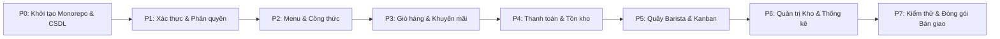

# Kế Hoạch Triển Khai Hệ Thống BrewLite (Implementation Plan)

> **Dự án**: BrewLite — Ứng dụng đặt đồ uống cà phê không dùng tiền mặt  
> **Phiên bản kế hoạch**: v1.0.0 | **Ngày lập**: 13/10/2026 | **Trạng thái**: CHỜ DUYỆT (Awaiting Approval)  
> **Tài liệu đặc tả liên kết**: [01-analysis-spec.md](./01-analysis-spec.md)  
> **Mô hình quản lý**: Agile Scrum (3 Sprints) kết hợp 8 Phase kỹ thuật tuần tự

---

## 0. Tổng quan Dự án (Executive Summary)

| Thông số dự án | Chi tiết định lượng |
|:---|:---|
| **Kiến trúc phần mềm** | Monorepo: Backend (NestJS 10) + Frontend (Next.js 14 App Router) + PostgreSQL 16 |
| **Công nghệ dữ liệu** | Prisma ORM 5.x (Schema, Migration, Seed), Docker Compose v2 |
| **Tổng số chức năng nguyên tử** | **81 chức năng nguyên tử** (chi tiết tại [01-analysis-spec.md](./01-analysis-spec.md)) |
| **Số Phase triển khai** | **8 Phases kỹ thuật** (Phase 0 đến Phase 7) tích hợp vào 3 Sprint Scrum |
| **Tổng thời lượng ước tính** | 160 giờ làm việc (tương đương 4 tuần làm việc chuẩn của nhóm dự án) |
| **Số chức năng chưa phân bổ** | **0** (100% chức năng nguyên tử đều có Task phụ trách cụ thể) |

---

## 1. Lộ trình Triển khai Tổng quan (Milestone Roadmap)

### Bảng Lộ trình Cấp cao (High-Level Milestones)
| Giai đoạn | Tên Phase Kỹ thuật | Sprint Scrum | Thời lượng | Mục tiêu cốt lõi | Sản phẩm bàn giao chính |
|:---|:---|:---:|:---:|:---|:---|
| **Phase 0** | Khởi tạo Dự án & Cơ sở dữ liệu | Sprint 1 | 16 giờ | Dựng bộ khung Monorepo, Docker Compose, Schema Prisma, Seed mẫu | Skeleton chạy Hello World, DB sẵn sàng với dữ liệu mẫu |
| **Phase 1** | Xác thực & Quản trị Tài khoản | Sprint 1 | 16 giờ | JWT Passport, Bcrypt, Guard RBAC (Customer/Staff/Admin), Swagger | Endpoint Auth hoạt động, tài khoản phân quyền bảo mật |
| **Phase 2** | Thực đơn & Biến thể Sản phẩm | Sprint 1 | 20 giờ | API Menu, lọc/tìm kiếm, UI Menu lưới responsive, màn Chi tiết món | Hoàn tất Sprint 1: Khách hàng xem được menu và chọn size |
| **Phase 3** | Giỏ hàng & Quản lý Khuyến mãi | Sprint 2 | 16 giờ | Client Zustand Cart, tính tổng tiền, API kiểm tra mã voucher | Giỏ hàng lưu trữ bền vững, tính giảm giá tự động |
| **Phase 4** | Đặt hàng, Thanh toán & Tồn kho | Sprint 2 | 28 giờ | State Machine đơn, Idempotency-Key, Optimistic Lock kho, Mock Gateway | Đặt hàng và trừ kho đồng thời an toàn, cộng điểm thưởng |
| **Phase 5** | Vận hành Quầy Barista & Lịch sử | Sprint 3 | 20 giờ | Bảng Kanban Barista kéo/thả/chuyển trạng thái, UI lịch sử đơn | Barista nhận và pha chế đơn hàng theo thời gian thực |
| **Phase 6** | Quản trị Kho, Nhập hàng & Thống kê | Sprint 3 | 24 giờ | Nhập kho (Supplier/ImportReceipt), kiểm duyệt Review, biểu đồ doanh thu | Hệ thống Admin hoàn chỉnh, quản lý chuỗi cung ứng |
| **Phase 7** | Kiểm thử Toàn diện & Bàn giao | Sprint 3 | 20 giờ | Test Unit & Integration (Jest/Supertest), Docker E2E, README bàn giao | Hệ thống hoàn thiện 100%, sẵn sàng chạy demo bảo vệ |

---

## 2. Kế hoạch Chi tiết Từng Giai đoạn (Tasks Checklist Cards)

---

### 🚀 Giai đoạn P0: Khởi tạo Dự án & Cơ sở Dữ liệu (16 giờ - Sprint 1)
> **Mục tiêu**: Thiết lập cấu trúc Monorepo tiêu chuẩn, khởi chạy container PostgreSQL qua Docker Compose, định nghĩa hoàn chỉnh Prisma Schema tương ứng 100% sơ đồ lớp DrawIO và nạp dữ liệu mẫu (Seed).  
> **Phạm vi chức năng nguyên tử**: Nền tảng hạ tầng phục vụ toàn bộ 81 chức năng.

#### Danh sách công việc chi tiết (Tasks Checklist):
- [ ] **[P0-01] Khởi tạo cấu trúc thư mục Monorepo & Cấu hình môi trường chuẩn** `(4h)`
  - **Module / File**: `docker-compose.yml`, `package.json`, `.gitignore`, `.env.example`, `README.md`
  - **Phụ thuộc**: Không
  - **Chi tiết**: Thiết lập Monorepo với thư mục `/backend` (NestJS) và `/frontend` (Next.js). Thiết lập file `docker-compose.yml` gồm 3 services: `postgres` (port 5432), `backend` (port 3001), `frontend` (port 3000) cùng mạng nội bộ (bridge network).
  - **Tiêu chuẩn nghiệm thu (DoD)**: Lệnh `docker compose up -d postgres` khởi chạy container cơ sở dữ liệu thành công; cả 2 ứng dụng frontend/backend đều có script `npm run dev` và `npm run build` không lỗi.

- [ ] **[P0-02] Xây dựng Schema Prisma bám sát 100% Sơ đồ lớp DrawIO** `(6h)`
  - **Module / File**: `backend/prisma/schema.prisma`
  - **Phụ thuộc**: P0-01
  - **Chi tiết**: Định nghĩa đầy đủ các model: `Account`, `Customer`, `Staff`, `Admin`, `Product`, `ProductVariant`, `OrderItem`, `Order`, `Payment`, `Promotion`, `Ingredient`, `Recipe`, `Supplier`, `ImportReceipt`, `ImportReceiptItem`, `Review`, `OrderStatusHistory`. Cấu hình quan hệ 1-1, 1-n, n-n và đánh index hiệu năng (`customerId`, `status`, `idempotencyKey`, `code`).
  - **Tiêu chuẩn nghiệm thu (DoD)**: Lệnh `npx prisma migrate dev --name init` thực thi thành công, tạo đầy đủ các bảng và khóa ngoại trong PostgreSQL không warning.

- [ ] **[P0-03] Xây dựng Script Seed dữ liệu mẫu phong phú** `(4h)`
  - **Module / File**: `backend/prisma/seed.ts`, `backend/package.json`
  - **Phụ thuộc**: P0-02
  - **Chi tiết**: Seed tài khoản mặc định (1 Admin, 2 Staff, 3 Customer mật khẩu bcrypt), $\ge 12$ sản phẩm đồ uống đa dạng kèm 3 kích cỡ (S, M, L) và topping; công thức định lượng chi tiết cho từng ly; danh mục nguyên liệu kho kèm số lượng tồn và `version = 1`; 3 nhà cung cấp; 3 phiếu nhập hàng mẫu; 3 mã khuyến mãi (`COFFEE10`, `FREESHIP`, `EXPIRED`); các đơn hàng mẫu ở các trạng thái khác nhau.
  - **Tiêu chuẩn nghiệm thu (DoD)**: Chạy `npx prisma db seed` không phát sinh lỗi; bảng `Product`, `ProductVariant`, `Ingredient`, `Recipe`, `Account` có đầy đủ bản ghi chuẩn xác.

- [ ] **[P0-04] Thiết lập Middleware cơ sở: Logger có cấu trúc & Global Filter** `(2h)`
  - **Module / File**: `backend/src/common/filters/http-exception.filter.ts`, `backend/src/common/interceptors/transform.interceptor.ts`
  - **Phụ thuộc**: P0-01
  - **Chi tiết**: Định dạng phản hồi JSON chuẩn `{ success, statusCode, data, message, timestamp }`, bắt toàn bộ lỗi unhandled và ghi log kèm correlation id.
  - **Tiêu chuẩn nghiệm thu (DoD)**: Khi endpoint ném lỗi bất kỳ, response trả về định dạng JSON thống nhất, không rò rỉ stack trace ra ngoài.

#### Tiêu chí nghiệm thu Phase 0 (Exit Criteria):
- [ ] Database khởi chạy và kết nối ổn định qua Prisma Client.
- [ ] Dữ liệu mẫu (Seed) nạp đầy đủ vào database.
- [ ] Cấu hình biến môi trường `.env.example` rõ ràng, có tài liệu hướng dẫn khởi tạo.

---

### 🔐 Giai đoạn P1: Xác thực & Phân quyền (Auth & RBAC) (16 giờ - Sprint 1)
> **Mục tiêu**: Xây dựng toàn bộ hệ thống đăng ký, đăng nhập JWT, băm mật khẩu Bcrypt, phân quyền theo Role (CUSTOMER, STAFF, ADMIN) và tài liệu hóa tự động bằng Swagger.  
> **Phạm vi chức năng nguyên tử**: 1.1.1, 1.1.2, 1.1.3, 1.1.4, 1.1.5, 1.1.6, 1.2.1, 1.2.2, 1.2.3, 1.2.4, 1.2.5, 1.2.6, 1.2.7.

#### Danh sách công việc chi tiết (Tasks Checklist):
- [ ] **[P1-01] Module Xác thực (Auth Service & Passport JWT)** `(5h)`
  - **Module / File**: `backend/src/modules/auth/*`, `backend/src/modules/auth/strategies/jwt.strategy.ts`
  - **Phụ thuộc**: P0-02
  - **Chi tiết**: Viết logic `POST /api/auth/register` (tạo `Account` + `Customer`), `POST /api/auth/login` (kiểm tra username/password bằng bcrypt, kiểm tra `status != LOCKED`, cấp phát Access Token 15 phút và Refresh Token 7 ngày), `POST /api/auth/refresh`, `POST /api/auth/logout`.
  - **Tiêu chuẩn nghiệm thu (DoD)**: Unit test cho Auth service pass 100%; tài khoản bị `LOCKED` không thể đăng nhập và trả mã lỗi `403 Forbidden`.

- [ ] **[P1-02] Phân quyền truy cập RBAC Guards & Decorators** `(4h)`
  - **Module / File**: `backend/src/common/guards/roles.guard.ts`, `backend/src/common/decorators/roles.decorator.ts`
  - **Phụ thuộc**: P1-01
  - **Chi tiết**: Xây dựng `@Roles('CUSTOMER', 'STAFF', 'ADMIN')` và Guard kiểm tra token JWT giải mã role của người dùng. Viết endpoint `GET /api/auth/me` và `POST /api/auth/change-password`.
  - **Tiêu chuẩn nghiệm thu (DoD)**: Khi token của Customer truy cập endpoint chỉ định Staff/Admin thì trả mã lỗi `403 Forbidden`.

- [ ] **[P1-03] API Quản trị Tài khoản & Nhân viên dành cho Admin** `(4h)`
  - **Module / File**: `backend/src/modules/admin/account-management.*`
  - **Phụ thuộc**: P1-02
  - **Chi tiết**: Viết các API: `GET /api/admin/accounts`, `PATCH /api/admin/accounts/:id/lock`, `PATCH /api/admin/accounts/:id/unlock`, `POST /api/admin/staff`, `GET /api/admin/staff`, `PATCH /api/admin/staff/:id`, `DELETE /api/admin/staff/:id`.
  - **Tiêu chuẩn nghiệm thu (DoD)**: Khóa tài khoản thành công; nhân viên bị khóa tài khoản lập tức bị từ chối truy cập ở các request tiếp theo.

- [ ] **[P1-04] Tích hợp Swagger OpenAPI & Validation Pipes** `(3h)`
  - **Module / File**: `backend/src/main.ts`, `backend/src/modules/*/dto/*`
  - **Phụ thuộc**: P1-01, P1-03
  - **Chi tiết**: Cấu hình Swagger UI tại `/api/docs` với đầy đủ DTO có chú thích `@ApiProperty()`, `@IsNotEmpty()`, `@IsEmail()`, `@MinLength(6)`.
  - **Tiêu chuẩn nghiệm thu (DoD)**: Truy cập `/api/docs` hiển thị đầy đủ tài liệu API, thử nghiệm gọi trực tiếp trên giao diện Swagger thành công.

#### Tiêu chí nghiệm thu Phase 1 (Exit Criteria):
- [ ] Swagger `/api/docs` hiển thị đẩy đủ nhóm endpoint Auth và Admin.
- [ ] Đăng ký/đăng nhập hoạt động mượt mà, phân quyền role bảo vệ các route private.

---

### ☕ Giai đoạn P2: Thực đơn & Biến thể Sản phẩm (Menu & Products) (20 giờ - Sprint 1)
> **Mục tiêu**: Hoàn thành toàn diện phân hệ quản lý thực đơn đồ uống, biến thể kích cỡ và công thức nguyên liệu trên cả Backend và Giao diện Khách hàng.  
> **Phạm vi chức năng nguyên tử**: 2.1.1, 2.1.2, 2.1.3, 2.1.4, 2.1.5, 2.1.6, 2.2.1, 2.2.2, 2.2.3, 2.2.4, 2.2.5, 2.2.6, 2.2.7, 2.2.8, 2.2.9.

#### Danh sách công việc chi tiết (Tasks Checklist):
- [ ] **[P2-01] Backend API Menu, Sản phẩm & Biến thể** `(6h)`
  - **Module / File**: `backend/src/modules/products/*`, `backend/src/modules/recipes/*`
  - **Phụ thuộc**: P1-02
  - **Chi tiết**: Viết `GET /api/products` (hỗ trợ phân trang `?page&limit`, tìm kiếm `?search`, lọc `?category`), `GET /api/products/:id` (kèm variants S/M/L, giá, topping, điểm đánh giá trung bình). Viết các API CRUD Admin: `/admin/products`, `/admin/variants`, `/admin/recipes`.
  - **Tiêu chuẩn nghiệm thu (DoD)**: API trả về menu đầy đủ trong thời gian $< 200\text{ms}$; tính toán điểm đánh giá sao trung bình chuẩn xác.

- [ ] **[P2-02] Frontend UI: Trang Thực đơn (Menu Grid & Filter)** `(7h)`
  - **Module / File**: `frontend/src/app/(customer)/page.tsx`, `frontend/src/components/menu/*`
  - **Phụ thuộc**: P2-01
  - **Chi tiết**: Xây dựng giao diện menu đồ uống theo phong cách cà phê hiện đại (màu nâu hạt/kem); thanh tìm kiếm nhanh có debounce; tabs phân loại danh mục (Cà phê, Trà sữa, Trà trái cây, Freeze); thẻ sản phẩm hiển thị ảnh, tên, giá khởi điểm từ size nhỏ nhất, nút "Chọn mua". Có skeleton loading và empty state khi không tìm thấy món.
  - **Tiêu chuẩn nghiệm thu (DoD)**: Giao diện chuẩn responsive trên mobile 375px và desktop; tìm kiếm và lọc danh mục phản hồi mượt mà không bị giật lag.

- [ ] **[P2-03] Frontend UI: Màn hình Chi tiết Sản phẩm & Tùy chọn Size/Topping** `(7h)`
  - **Module / File**: `frontend/src/app/(customer)/products/[id]/page.tsx`, `frontend/src/components/product-detail/*`
  - **Phụ thuộc**: P2-02
  - **Chi tiết**: Màn hình xem ảnh lớn, mô tả món; bộ chọn kích cỡ Size (S / M / L); danh sách topping tùy chọn (Trân châu trắng, Kem cheese, Thạch); tự động tính toán tổng đơn giá theo size và topping được chọn; nút "Thêm vào giỏ hàng" kèm thông báo toast thành công.
  - **Tiêu chuẩn nghiệm thu (DoD)**: Đổi size hoặc tích chọn topping lập tức cập nhật giá tiền chính xác trên nút thêm vào giỏ.

#### Tiêu chí nghiệm thu Phase 2 (Exit Criteria - Kết thúc Sprint 1):
- [ ] Hoàn tất toàn bộ Task 1, 2, 3, 4 theo chuẩn Đề bài bài tập lớn (đạt 4/10 điểm Sprint 1).
- [ ] Khách hàng duyệt menu, tìm kiếm, xem chi tiết và tùy chọn size/topping trên giao diện web.

---

### 🛒 Giai đoạn P3: Giỏ hàng & Quản lý Khuyến mãi (Cart & Promotions) (16 giờ - Sprint 2)
> **Mục tiêu**: Xây dựng Store quản lý giỏ hàng phía Client bền vững (Zustand persist LocalStorage), tích hợp mã khuyến mãi và chuẩn bị dữ liệu tạo đơn hàng.  
> **Phạm vi chức năng nguyên tử**: 3.1.1, 3.1.2, 3.1.3, 3.1.4, 3.1.5, 3.2.1, 3.2.2, 3.2.3, 3.2.4, 3.2.5, 3.2.6.

#### Danh sách công việc chi tiết (Tasks Checklist):
- [ ] **[P3-01] Frontend Zustand Cart Store với LocalStorage Persistence** `(5h)`
  - **Module / File**: `frontend/src/store/useCartStore.ts`
  - **Phụ thuộc**: P2-03
  - **Chi tiết**: Xây dựng store giỏ hàng: thêm món, cập nhật số lượng, xóa món, xóa sạch giỏ; lưu trữ an toàn trong `localStorage` để khi F5 không bị mất dữ liệu; tính toán tự động số lượng ly (badge giỏ hàng trên Header) và tổng tiền tạm tính (`subtotal`).
  - **Tiêu chuẩn nghiệm thu (DoD)**: Unit test cho Cart store bao phủ các case: thêm cùng món cùng size gộp số lượng; thêm cùng món khác size tách dòng riêng; xóa món giảm tổng tiền chuẩn xác.

- [ ] **[P3-02] Backend Module Khuyến mãi (Promotion Validation & Admin CRUD)** `(5h)`
  - **Module / File**: `backend/src/modules/promotions/*`
  - **Phụ thuộc**: P0-02
  - **Chi tiết**: Viết `POST /api/promotions/validate`: kiểm tra mã tồn tại, còn hạn (`now between startDate and endDate`), còn lượt sử dụng (`usedCount < quantity`), trạng thái active; tính toán mức giảm giá theo `PERCENT` (có chặn trần tối đa) hoặc `FIXED`. Viết các API CRUD Admin cho khuyến mãi.
  - **Tiêu chuẩn nghiệm thu (DoD)**: Mã hết hạn hoặc vượt quá lượt dùng trả về mã lỗi `400 Bad Request` với lý do rõ ràng.

- [ ] **[P3-03] Frontend UI: Trang Giỏ hàng & Áp dụng Mã Giảm Giá** `(6h)`
  - **Module / File**: `frontend/src/app/(customer)/cart/page.tsx`, `frontend/src/components/cart/*`
  - **Phụ thuộc**: P3-01, P3-02
  - **Chi tiết**: Hiển thị danh sách từng ly trong giỏ (ảnh nhỏ, tên món, size, topping, đơn giá, nút tăng giảm số lượng, nút thùng rác xóa món); ô nhập mã voucher kèm nút "Áp dụng"; hiển thị chi tiết dòng: Tạm tính, Giảm giá voucher, Tổng thanh toán; nút "Tiến hành Đặt hàng".
  - **Tiêu chuẩn nghiệm thu (DoD)**: Áp dụng mã thành công thì hiển thị số tiền được giảm rõ ràng và trừ vào tổng tiền thanh toán; nếu mã sai thì hiển thị toast lỗi đỏ.

#### Tiêu chí nghiệm thu Phase 3 (Exit Criteria):
- [ ] Giỏ hàng hoạt động mượt mà, lưu trữ bền vững.
- [ ] Xác thực mã khuyến mãi chính xác theo nghiệp vụ.

---

### 💳 Giai đoạn P4: Đặt hàng, Thanh toán & Kiểm soát Tồn kho Đồng thời (28 giờ - Sprint 2)
> **Mục tiêu**: Hiện thực hóa toàn bộ nghiệp vụ cốt lõi nâng cao (Task 10 đề bài): Máy trạng thái đơn hàng (Order State Machine), Thanh toán Idempotent, Trừ kho bằng Optimistic Locking, Tích lũy điểm thưởng và Cổng thanh toán giả lập.  
> **Phạm vi chức năng nguyên tử**: 4.1.1, 4.1.2, 4.1.3, 4.1.4, 4.1.5, 4.2.1, 4.2.2, 4.2.3, 4.2.4, 4.2.5, 4.2.6, 4.2.7.

#### Danh sách công việc chi tiết (Tasks Checklist):
- [ ] **[P4-01] Backend API Tạo đơn hàng & Order State Machine** `(6h)`
  - **Module / File**: `backend/src/modules/orders/*`, `backend/src/modules/orders/order-state-machine.ts`
  - **Phụ thuộc**: P3-02
  - **Chi tiết**: Viết hàm `assertTransition(fromStatus, toStatus)` chặn đứng mọi chuyển đổi phi hợp lệ. Viết `POST /api/orders` nhận danh sách item từ giỏ hàng, validate giá trị, tạo bản ghi `Order` ở trạng thái `PENDING`, tạo các `OrderItem` tương ứng trong 1 Transaction.
  - **Tiêu chuẩn nghiệm thu (DoD)**: Chuyển đổi trạng thái từ `PENDING` sang `COMPLETED` trực tiếp bị ném `ConflictException`; tạo đơn thành công trả về mã đơn hàng `#ID`.

- [ ] **[P4-02] Mock Payment Gateway Service độc lập** `(4h)`
  - **Module / File**: `backend/src/modules/payment/mock-gateway/*`
  - **Phụ thuộc**: P0-01
  - **Chi tiết**: Xây dựng module cổng thanh toán giả lập: xử lý request nạp tiền giả định với các phương thức Ví điện tử (Momo/ZaloPay) và Thẻ ngân hàng. Cung cấp cờ cấu hình (hoặc header test) để mô phỏng 3 kịch bản: `SUCCESS`, `FAILED`, `TIMEOUT`.
  - **Tiêu chuẩn nghiệm thu (DoD)**: Cổng thanh toán phản hồi đúng mã giao dịch giả lập và kết quả tương ứng kịch bản kiểm thử.

- [ ] **[P4-03] Thanh toán Idempotent & Xử lý Trùng lặp Giao dịch** `(6h)`
  - **Module / File**: `backend/src/modules/payment/payment.service.ts`, `backend/src/modules/payment/payment.controller.ts`
  - **Phụ thuộc**: P4-01, P4-02
  - **Chi tiết**: Viết `POST /api/payments` bắt buộc có Header `Idempotency-Key`. Kiểm tra trong DB: nếu đã có key với cùng payload thì trả ngay kết quả giao dịch trước đó mà không xử lý lại; nếu cùng key nhưng khác payload thì ném lỗi `422 Unprocessable Entity`. Sử dụng unique constraint trên cột `idempotencyKey` để chống Race Condition.
  - **Tiêu chuẩn nghiệm thu (DoD)**: Gửi 2 request thanh toán đồng thời cùng key chỉ tạo duy nhất 1 giao dịch thành công.

- [ ] **[P4-04] Kiểm soát Tồn kho Đồng thời bằng Optimistic Locking** `(6h)`
  - **Module / File**: `backend/src/modules/inventory/inventory.service.ts`
  - **Phụ thuộc**: P4-03
  - **Chi tiết**: Khi thanh toán thành công, trong 1 DB Transaction: tính tổng nguyên liệu cần dựa trên công thức (`Recipe`), kiểm tra `stockQuantity`, cập nhật bằng câu lệnh: `UPDATE "Ingredient" SET "stockQuantity" = "stockQuantity" - $qty, "version" = "version" + 1 WHERE "id" = $id AND "version" = $ver AND "stockQuantity" >= $qty`. Nếu xung đột phiên bản, tự động retry tối đa 3 lần. Nếu thiếu hàng, rollback toàn bộ và báo lỗi cụ thể tên nguyên liệu.
  - **Tiêu chuẩn nghiệm thu (DoD)**: Chạy test giả lập 20 request đồng thời đặt món không làm tồn kho nguyên liệu bị âm.

- [ ] **[P4-05] Điểm thưởng Loyalty & Nghiệp vụ Hủy/Hoàn tiền** `(3h)`
  - **Module / File**: `backend/src/modules/orders/orders.service.ts`
  - **Phụ thuộc**: P4-04
  - **Chi tiết**: Khi đơn chuyển sang `PAID`, cộng điểm thưởng cho khách (1 điểm / 10.000 VNĐ sau giảm giá). Viết `POST /api/orders/:id/cancel` cho phép khách hủy đơn khi còn ở `PENDING` hoặc `PAID` (chưa sang `PREPARING`): tự động hoàn lại số lượng tồn kho nguyên liệu (`HoanSoLuong`), trừ lại điểm thưởng đã cộng và hoàn lại lượt mã voucher.
  - **Tiêu chuẩn nghiệm thu (DoD)**: Hủy đơn `PAID` hoàn trả kho chính xác 100%, không bị double refund.

- [ ] **[P4-06] Frontend UI: Trang Thanh toán & Màn hình Xác nhận Đơn** `(3h)`
  - **Module / File**: `frontend/src/app/(customer)/checkout/page.tsx`, `frontend/src/app/(customer)/orders/[id]/page.tsx`
  - **Phụ thuộc**: P4-03, P4-05
  - **Chi tiết**: Giao diện chọn Ví điện tử / Thẻ; nút thanh toán tự động sinh Idempotency-Key; hiệu ứng loading khi chờ cổng thanh toán phản hồi; chuyển hướng sang màn hình Xác nhận đơn hiển thị mã đơn, badge trạng thái `PAID` và thông điệp mời tới quầy nhận nước.
  - **Tiêu chuẩn nghiệm thu (DoD)**: Toàn bộ luồng từ giỏ hàng đến thanh toán và hiển thị màn xác nhận hoạt động trơn tru.

#### Tiêu chí nghiệm thu Phase 4 (Exit Criteria - Kết thúc Sprint 2):
- [ ] Hoàn tất toàn bộ Task 5, 6, 7, 8 và phần cốt lõi của Task 10 đề bài (đạt 8/10 điểm).
- [ ] Đơn hàng thanh toán thành công, trừ kho an toàn dưới tải đồng thời, có idempotency key.

---

### ☕ Giai đoạn P5: Vận hành Quầy Barista & Lịch sử Đơn (20 giờ - Sprint 3)
> **Mục tiêu**: Xây dựng bảng Kanban chuyên dụng cho nhân viên pha chế (Barista) tiếp nhận và đổi trạng thái đơn hàng thời gian thực; giao diện xem lịch sử đơn và hủy đơn cho khách hàng.  
> **Phạm vi chức năng nguyên tử**: 5.1.1, 5.1.2, 5.1.3, 5.1.4, 5.1.5, 5.1.6, 4.1.3, 4.1.4, 4.1.5.

#### Danh sách công việc chi tiết (Tasks Checklist):
- [ ] **[P5-01] Backend API Vận hành Barista** `(5h)`
  - **Module / File**: `backend/src/modules/staff/*`
  - **Phụ thuộc**: P4-01
  - **Chi tiết**: Viết các API dành riêng cho Role `STAFF`: `GET /api/staff/orders` (lọc theo trạng thái `status`), `POST /api/staff/orders/:id/accept` (nhận đơn, gán `staffId`, chuyển `PREPARING`), `POST /api/staff/orders/:id/ready` (chuyển `READY`), `POST /api/staff/orders/:id/complete` (chuyển `COMPLETED`), `GET /api/staff/orders/:id/recipes` (xem công thức định lượng chi tiết cần pha).
  - **Tiêu chuẩn nghiệm thu (DoD)**: Staff nhận đơn hợp lệ; mọi hành động chuyển sai thứ tự trạng thái đều bị ném lỗi.

- [ ] **[P5-02] Frontend UI: Bảng Kanban Pha chế dành cho Barista** `(8h)`
  - **Module / File**: `frontend/src/app/(staff)/staff/orders/page.tsx`, `frontend/src/components/staff/*`
  - **Phụ thuộc**: P5-01
  - **Chi tiết**: Bảng Kanban 3 cột trực quan: "Chờ pha (PAID)" ➔ "Đang pha chế (PREPARING)" ➔ "Đã pha xong (READY)". Thẻ đơn hàng hiển thị mã đơn, thời gian chờ, danh sách ly kèm size và topping; nút bấm chuyển tiếp trạng thái tương ứng; cơ chế tự động làm mới (polling mỗi 5 giây) để nhận đơn mới mà không cần F5.
  - **Tiêu chuẩn nghiệm thu (DoD)**: Barista nhấn "Bắt đầu pha" thẻ đơn lập tức bay sang cột đang pha; UI phản hồi nhanh chóng $< 300\text{ms}$.

- [ ] **[P5-03] Frontend UI: Lịch sử Đơn hàng & Theo dõi Trạng thái của Khách** `(7h)`
  - **Module / File**: `frontend/src/app/(customer)/orders/me/page.tsx`, `frontend/src/app/(customer)/profile/page.tsx`
  - **Phụ thuộc**: P4-06
  - **Chi tiết**: Màn hình xem danh sách các đơn đã đặt (phân loại Đang thực hiện / Đã hoàn thành); hiển thị stepper tiến độ (Đã đặt ➔ Đã thanh toán ➔ Đang pha ➔ Sẵn sàng ➔ Hoàn tất); nút "Hủy đơn" chỉ hiển thị khi đơn còn ở `PENDING` hoặc `PAID`; màn hình Profile hiển thị điểm tích lũy và lịch sử tích điểm.
  - **Tiêu chuẩn nghiệm thu (DoD)**: Khách hàng theo dõi được trạng thái đơn thay đổi theo thao tác của Barista.

#### Tiêu chí nghiệm thu Phase 5 (Exit Criteria):
- [ ] Luồng pha chế tại quầy Barista hoạt động hoàn chỉnh từ tiếp nhận đến bàn giao.
- [ ] Khách hàng theo dõi đơn hàng và xem lịch sử đơn của chính mình.

---

### 📊 Giai đoạn P6: Quản trị Kho, Nhập hàng & Thống kê (24 giờ - Sprint 3)
> **Mục tiêu**: Xây dựng toàn diện phân hệ quản lý kho nguyên liệu, lập phiếu nhập kho tự động cộng dồn tồn kho, kiểm duyệt đánh giá món và báo cáo doanh thu kinh doanh cho Quản trị viên (Admin).  
> **Phạm vi chức năng nguyên tử**: 6.1.1, 6.1.2, 6.1.3, 6.1.4, 6.1.5, 6.2.1, 6.2.2, 6.2.3, 6.2.4, 6.2.5, 6.2.6, 6.2.7, 7.1.1, 7.1.2, 7.1.3, 7.1.4, 7.1.5, 7.2.1, 7.2.2, 7.2.3, 8.1.1, 8.1.2, 8.1.3, 8.1.4.

#### Danh sách công việc chi tiết (Tasks Checklist):
- [ ] **[P6-01] Backend Module Quản lý Kho & Phiếu Nhập Kho** `(6h)`
  - **Module / File**: `backend/src/modules/inventory/*`, `backend/src/modules/suppliers/*`
  - **Phụ thuộc**: P0-02
  - **Chi tiết**: Viết API quản lý nguyên liệu: `GET/POST/PATCH/DELETE /api/admin/ingredients`; quản lý nhà cung cấp: `GET/POST/PATCH/DELETE /api/admin/suppliers`; lập phiếu nhập kho: `POST /api/admin/import-receipts`. Trong một Transaction: lưu phiếu nhập, lưu chi tiết phiếu và tự động cộng dồn `stockQuantity` của nguyên liệu tương ứng.
  - **Tiêu chuẩn nghiệm thu (DoD)**: Lập phiếu nhập kho thành công thì tồn kho của các nguyên liệu liên quan tăng chính xác bằng số lượng nhập.

- [ ] **[P6-02] Backend Module Đánh giá Sản phẩm & Điều kiện Đã mua (KiemTraDaMua)** `(5h)`
  - **Module / File**: `backend/src/modules/reviews/*`
  - **Phụ thuộc**: P4-01
  - **Chi tiết**: Viết `POST /api/reviews`: bắt buộc kiểm tra khách hàng đã có đơn hàng chứa sản phẩm đó ở trạng thái `COMPLETED` (`KiemTraDaMua`); mỗi cặp (customer, product, order) chỉ được đánh giá 1 lần; tính điểm sao trung bình của sản phẩm; viết các API Admin ẩn/hiện đánh giá.
  - **Tiêu chuẩn nghiệm thu (DoD)**: Khách hàng chưa mua hoặc đơn chưa `COMPLETED` khi đánh giá bị ném lỗi `403 Forbidden`.

- [ ] **[P6-03] Backend Module Thống kê & Báo cáo Doanh thu** `(5h)`
  - **Module / File**: `backend/src/modules/admin/stats/*`
  - **Phụ thuộc**: P4-01
  - **Chi tiết**: Viết các API thống kê: `GET /api/admin/stats/overview` (tổng doanh thu, tổng đơn hàng, tổng khách hàng, tổng ly nước đã bán), `GET /api/admin/stats/revenue` (doanh thu theo ngày/tuần/tháng), `GET /api/admin/stats/top-products` (top 5 sản phẩm bán chạy nhất), `GET /api/admin/stats/orders-by-status`.
  - **Tiêu chuẩn nghiệm thu (DoD)**: Dữ liệu thống kê khớp chuẩn xác 100% với các đơn hàng ở trạng thái `PAID` và `COMPLETED`.

- [ ] **[P6-04] Frontend Admin Portal: Dashboard & Quản lý Kho, Đánh giá** `(8h)`
  - **Module / File**: `frontend/src/app/(admin)/admin/*`, `frontend/src/components/admin/*`
  - **Phụ thuộc**: P6-01, P6-02, P6-03
  - **Chi tiết**: Xây dựng Admin Dashboard với biểu đồ doanh thu (Recharts); bảng quản lý tồn kho nguyên liệu kèm cảnh báo màu đỏ với nguyên liệu dưới ngưỡng tối thiểu; form tạo phiếu nhập kho nhanh; bảng duyệt đánh giá khách hàng (nút Ẩn/Hiện); bảng quản lý danh mục và khuyến mãi.
  - **Tiêu chuẩn nghiệm thu (DoD)**: Admin thao tác nhập kho và kiểm duyệt đánh giá mượt mà, số liệu biểu đồ cập nhật trực quan.

#### Tiêu chí nghiệm thu Phase 6 (Exit Criteria):
- [ ] Phân hệ Quản trị Admin hoạt động đầy đủ, quản lý được kho, nhà cung cấp, đánh giá và số liệu tài chính.

---

### 🛡️ Giai đoạn P7: Kiểm thử Toàn diện, Đóng gói & Bàn giao (20 giờ - Sprint 3)
> **Mục tiêu**: Thực hiện toàn bộ kiểm thử Unit & Integration bắt buộc theo tiêu chí chấm điểm, đóng gói Docker Compose khởi chạy 1 lệnh, hoàn thiện tài liệu bàn giao bài tập lớn.  
> **Phạm vi chức năng nguyên tử**: Kiểm thử và xác thực toàn bộ 81 chức năng hệ thống.

#### Danh sách công việc chi tiết (Tasks Checklist):
- [ ] **[P7-01] Xây dựng Bộ Kiểm thử Backend Tự động (Unit & Integration Tests)** `(8h)`
  - **Module / File**: `backend/test/*`, `backend/src/**/*.spec.ts`
  - **Phụ thuộc**: P4-04, P4-05, P6-02
  - **Chi tiết**: Viết test bằng Jest + Supertest chứng minh 7 kịch bản bắt buộc của Task 10:
    1. Chặn chuyển trạng thái sai trong State Machine (ném ngoại lệ).
    2. Gửi 2 lần cùng `Idempotency-Key` chỉ tạo duy nhất 1 giao dịch và 1 lần trừ kho.
    3. Gửi 20 request đặt đồng thời không làm tồn kho nguyên liệu bị âm.
    4. Mã khuyến mãi hết lượt sử dụng bị từ chối khi nhiều request gọi cùng lúc.
    5. Hủy đơn hàng `PAID` hoàn trả đủ tồn kho nguyên liệu, điểm thưởng và lượt mã.
    6. Kiểm tra RBAC: Customer không thể gọi API của Staff hoặc Admin.
    7. Chỉ cho phép đánh giá khi khách đã mua và đơn đã `COMPLETED`.
  - **Tiêu chuẩn nghiệm thu (DoD)**: Lệnh `npm run test` và `npm run test:e2e` chạy pass 100%, độ bao phủ kiểm thử logic nghiệp vụ $\ge 80\%$.

- [ ] **[P7-02] Đóng gói & Tối ưu hóa Docker Compose Đa Dịch vụ** `(4h)`
  - **Module / File**: `docker-compose.yml`, `backend/Dockerfile`, `frontend/Dockerfile`
  - **Phụ thuộc**: P0-01
  - **Chi tiết**: Tối ưu Dockerfile đa tầng (Multi-stage build) cho cả NestJS và Next.js; thiết lập entrypoint script cho backend tự động chạy `npx prisma migrate deploy` và `npx prisma db seed` trước khi khởi động server.
  - **Tiêu chuẩn nghiệm thu (DoD)**: Trên môi trường máy sạch, chỉ cần chạy duy nhất lệnh `docker compose up --build` là toàn bộ 3 dịch vụ (Postgres, Backend, Frontend) tự khởi chạy thành công và sẵn sàng phục vụ.

- [ ] **[P7-03] Hoàn thiện Bộ Tài liệu Dự án & Hướng dẫn Bàn giao** `(4h)`
  - **Module / File**: `README.md`, `docs/ARCHITECTURE.md`, `docs/DECISIONS.md`, `docs/API.md`
  - **Phụ thuộc**: P7-02
  - **Chi tiết**: Viết `README.md` chi tiết: hướng dẫn cài đặt local, chạy qua docker, danh sách tài khoản demo (Admin, Staff, Customer), cách chạy test suite; `docs/DECISIONS.md` ghi nhận các quyết định thiết kế kỹ thuật; xuất bộ sưu tập Postman Collection kiểm thử API.
  - **Tiêu chuẩn nghiệm thu (DoD)**: Tài liệu đầy đủ, minh bạch, có thể chuyển giao cho bất kỳ ai chạy được ngay trong vòng 5 phút.

- [ ] **[P7-04] Rà soát Giao diện & Kiểm thử Kịch bản Bàn giao End-to-End** `(4h)`
  - **Module / File**: Toàn bộ dự án
  - **Phụ thuộc**: P7-01, P7-02
  - **Chi tiết**: Thực hiện kịch bản demo trọn vẹn: Khách hàng đăng nhập ➔ Chọn 2 ly cà phê (chọn size/topping) ➔ Vào giỏ áp mã giảm giá ➔ Thanh toán không tiền mặt ➔ Barista nhận đơn và pha chế trên Kanban ➔ Khách nhận đồ uống ➔ Khách đánh giá món 5 sao ➔ Admin đăng nhập xem tồn kho giảm và doanh thu tăng trên biểu đồ.
  - **Tiêu chuẩn nghiệm thu (DoD)**: Luồng demo mượt mà 100%, không phát sinh bất kỳ lỗi console hay crash server nào.

#### Tiêu chí nghiệm thu Phase 7 (Exit Criteria - Bàn giao hoàn tất):
- [ ] Lệnh `docker compose up` chạy thành công toàn bộ hệ thống kèm dữ liệu mẫu.
- [ ] 100% Test suite pass.
- [ ] Đạt chuẩn 10/10 điểm theo tiêu chí bài tập lớn môn Công nghệ Phần mềm.

---

## 3. Ma trận Đối soát Chức năng (Traceability Matrix)

Đảm bảo **100% (81/81)** chức năng nguyên tử từ `01-analysis-spec.md` đều được phân bổ chính xác cho các Task trong kế hoạch:

| Phân hệ chức năng | Mã chức năng nguyên tử | Tên chức năng nguyên tử | Task phụ trách | Phase |
|:---|:---:|:---|:---:|:---:|
| **1. Auth & Accounts** | 1.1.1 | Đăng ký tài khoản khách hàng | P1-01 | Phase 1 |
| | 1.1.2 | Đăng nhập hệ thống nhận JWT | P1-01 | Phase 1 |
| | 1.1.3 | Làm mới Access Token | P1-01 | Phase 1 |
| | 1.1.4 | Đăng xuất hệ thống | P1-01 | Phase 1 |
| | 1.1.5 | Xem thông tin tài khoản hiện tại | P1-02 | Phase 1 |
| | 1.1.6 | Đổi mật khẩu tài khoản | P1-02 | Phase 1 |
| | 1.2.1 | Xem danh sách tài khoản | P1-03 | Phase 1 |
| | 1.2.2 | Khóa tài khoản người dùng | P1-03 | Phase 1 |
| | 1.2.3 | Mở khóa tài khoản người dùng | P1-03 | Phase 1 |
| | 1.2.4 | Tạo mới tài khoản nhân viên | P1-03 | Phase 1 |
| | 1.2.5 | Xem danh sách nhân viên quầy | P1-03 | Phase 1 |
| | 1.2.6 | Cập nhật thông tin nhân viên | P1-03 | Phase 1 |
| | 1.2.7 | Xóa hồ sơ nhân viên | P1-03 | Phase 1 |
| **2. Menu & Catalog** | 2.1.1 | Xem danh sách sản phẩm | P2-01, P2-02 | Phase 2 |
| | 2.1.2 | Tìm kiếm sản phẩm theo tên | P2-01, P2-02 | Phase 2 |
| | 2.1.3 | Lọc sản phẩm theo danh mục | P2-01, P2-02 | Phase 2 |
| | 2.1.4 | Xem chi tiết thông tin sản phẩm | P2-01, P2-03 | Phase 2 |
| | 2.1.5 | Xem danh sách biến thể size và topping | P2-01, P2-03 | Phase 2 |
| | 2.1.6 | Tính giá biến thể theo tùy chọn | P2-03 | Phase 2 |
| | 2.2.1 | Tạo mới sản phẩm đồ uống | P2-01 | Phase 2 |
| | 2.2.2 | Cập nhật thông tin sản phẩm | P2-01 | Phase 2 |
| | 2.2.3 | Ẩn hoặc xóa sản phẩm | P2-01 | Phase 2 |
| | 2.2.4 | Thêm biến thể kích cỡ sản phẩm | P2-01 | Phase 2 |
| | 2.2.5 | Cập nhật đơn giá biến thể | P2-01 | Phase 2 |
| | 2.2.6 | Xóa biến thể sản phẩm | P2-01 | Phase 2 |
| | 2.2.7 | Thiết lập công thức nguyên liệu cho biến thể | P2-01 | Phase 2 |
| | 2.2.8 | Cập nhật định lượng công thức | P2-01 | Phase 2 |
| | 2.2.9 | Xóa nguyên liệu khỏi công thức | P2-01 | Phase 2 |
| **3. Cart & Promotions** | 3.1.1 | Thêm món vào giỏ hàng | P3-01 | Phase 3 |
| | 3.1.2 | Cập nhật số lượng món trong giỏ | P3-01 | Phase 3 |
| | 3.1.3 | Xóa từng món khỏi giỏ hàng | P3-01 | Phase 3 |
| | 3.1.4 | Xóa toàn bộ giỏ hàng | P3-01 | Phase 3 |
| | 3.1.5 | Tính toán tổng tiền giỏ hàng | P3-01 | Phase 3 |
| | 3.2.1 | Xác thực và kiểm tra mã khuyến mãi | P3-02, P3-03 | Phase 3 |
| | 3.2.2 | Hủy áp dụng mã khuyến mãi khỏi giỏ | P3-03 | Phase 3 |
| | 3.2.3 | Xem danh sách chương trình khuyến mãi | P3-02 | Phase 3 |
| | 3.2.4 | Tạo mới chương trình khuyến mãi | P3-02 | Phase 3 |
| | 3.2.5 | Cập nhật chương trình khuyến mãi | P3-02 | Phase 3 |
| | 3.2.6 | Hủy kích hoạt chương trình khuyến mãi | P3-02 | Phase 3 |
| **4. Orders & Payments** | 4.1.1 | Tạo đơn hàng mới (PENDING) | P4-01 | Phase 4 |
| | 4.1.2 | Xem chi tiết đơn hàng | P4-01, P4-06 | Phase 4 |
| | 4.1.3 | Xem danh sách lịch sử đơn của khách | P5-03 | Phase 5 |
| | 4.1.4 | Hủy đơn hàng hợp lệ | P4-05, P5-03 | Phase 4, 5 |
| | 4.1.5 | Theo dõi trạng thái đơn hàng | P4-06, P5-03 | Phase 4, 5 |
| | 4.2.1 | Gửi yêu cầu thanh toán kèm Idempotency-Key | P4-03, P4-06 | Phase 4 |
| | 4.2.2 | Xử lý cổng thanh toán giả lập | P4-02 | Phase 4 |
| | 4.2.3 | Khấu trừ tồn kho nguyên liệu (Optimistic Lock)| P4-04 | Phase 4 |
| | 4.2.4 | Hoàn trả tồn kho nguyên liệu khi hủy | P4-05 | Phase 4 |
| | 4.2.5 | Tích lũy điểm thưởng khi PAID | P4-05 | Phase 4 |
| | 4.2.6 | Hoàn trả điểm thưởng và lượt mã khi hủy | P4-05 | Phase 4 |
| | 4.2.7 | Ghi nhận lịch sử OrderStatusHistory | P4-01, P4-03 | Phase 4 |
| **5. Barista Operations** | 5.1.1 | Xem bảng Kanban danh sách đơn | P5-01, P5-02 | Phase 5 |
| | 5.1.2 | Lọc đơn hàng theo cột trạng thái | P5-01, P5-02 | Phase 5 |
| | 5.1.3 | Nhận đơn hàng chuyển sang PREPARING | P5-01, P5-02 | Phase 5 |
| | 5.1.4 | Hoàn tất pha chế chuyển sang READY | P5-01, P5-02 | Phase 5 |
| | 5.1.5 | Giao đồ uống chuyển sang COMPLETED | P5-01, P5-02 | Phase 5 |
| | 5.1.6 | Xem chi tiết công thức pha chế của từng ly | P5-01, P5-02 | Phase 5 |
| **6. Inventory & Supply**| 6.1.1 | Xem danh mục tồn kho nguyên liệu | P6-01, P6-04 | Phase 6 |
| | 6.1.2 | Thêm mới nguyên liệu vào kho | P6-01 | Phase 6 |
| | 6.1.3 | Cập nhật định mức nguyên liệu | P6-01 | Phase 6 |
| | 6.1.4 | Xóa nguyên liệu khỏi hệ thống | P6-01 | Phase 6 |
| | 6.1.5 | Xem cảnh báo nguyên liệu chạm ngưỡng | P6-01, P6-04 | Phase 6 |
| | 6.2.1 | Xem danh sách nhà cung cấp | P6-01 | Phase 6 |
| | 6.2.2 | Thêm mới nhà cung cấp | P6-01 | Phase 6 |
| | 6.2.3 | Cập nhật thông tin nhà cung cấp | P6-01 | Phase 6 |
| | 6.2.4 | Xóa thông tin nhà cung cấp | P6-01 | Phase 6 |
| | 6.2.5 | Xem danh sách phiếu nhập kho | P6-01 | Phase 6 |
| | 6.2.6 | Tạo phiếu nhập kho và tự động cộng dồn kho | P6-01, P6-04 | Phase 6 |
| | 6.2.7 | Xem chi tiết phiếu nhập kho | P6-01 | Phase 6 |
| **7. Reviews & Feedback**| 7.1.1 | Xem danh sách đánh giá của sản phẩm | P2-01, P6-02 | Phase 2, 6 |
| | 7.1.2 | Kiểm tra điều kiện đã mua (KiemTraDaMua) | P6-02 | Phase 6 |
| | 7.1.3 | Gửi đánh giá số sao và nhận xét | P6-02 | Phase 6 |
| | 7.1.4 | Cập nhật nội dung đánh giá của mình | P6-02 | Phase 6 |
| | 7.1.5 | Xóa đánh giá của mình | P6-02 | Phase 6 |
| | 7.2.1 | Xem toàn bộ đánh giá cần kiểm duyệt | P6-02, P6-04 | Phase 6 |
| | 7.2.2 | Ẩn đánh giá vi phạm tiêu chuẩn | P6-02, P6-04 | Phase 6 |
| | 7.2.3 | Bỏ ẩn/Khôi phục đánh giá hiển thị | P6-02, P6-04 | Phase 6 |
| **8. Analytics & Stats** | 8.1.1 | Xem số liệu thống kê tổng quan | P6-03, P6-04 | Phase 6 |
| | 8.1.2 | Xem biểu đồ doanh thu ngày/tuần/tháng | P6-03, P6-04 | Phase 6 |
| | 8.1.3 | Xem thống kê top sản phẩm bán chạy | P6-03, P6-04 | Phase 6 |
| | 8.1.4 | Xem thống kê tỷ trọng đơn theo trạng thái | P6-03, P6-04 | Phase 6 |

> **Tổng kết đối soát**: **81/81 chức năng nguyên tử đã được phân bổ đầy đủ**. Số chức năng chưa phân bổ: **0**.

---

## 4. Quản Lý Rủi Ro Dự Án (Risk Register)

| Mã | Rủi ro tiềm ẩn | Mức độ | Tác động dự án | Chiến lược Giảm thiểu & Khắc phục |
|:---:|:---|:---:|:---|:---|
| **R-01** | Xung đột phiên bản tồn kho (Optimistic Lock Collision) khi nhiều đơn đặt đồng thời | Cao | Lỗi thanh toán hoặc thất thoát nguyên liệu | Áp dụng cơ chế Retry tự động tối đa 3 lần với exponential backoff; sử dụng DB transaction mức Serializable/Repeatable Read khi trừ kho. |
| **R-02** | Khách hàng bấm thanh toán nhiều lần gây trùng lặp giao dịch (Double Charge) | Cao | Trừ tiền trùng lặp, tạo đơn ảo | Bắt buộc client sinh `Idempotency-Key` (UUIDv4) trên header; DB đặt unique constraint cho key; đọc lại giao dịch cũ nếu trùng key + payload. |
| **R-03** | Khách hủy đơn sau khi Barista đã bắt đầu pha chế đồ uống | Trung bình | Lãng phí nguyên vật liệu | Cài đặt logic chặn hủy đơn trong `assertTransition`: chỉ cho phép hủy khi trạng thái là `PENDING` hoặc `PAID`. Khi đã `PREPARING` thì nút Hủy bị vô hiệu hóa. |
| **R-04** | Lệch chuẩn kết nối Docker giữa Next.js và NestJS trên các hệ điều hành khác nhau | Trung bình | Lỗi gọi API SSR khi dựng container | Dùng Docker Network nội bộ với tên dịch vụ `http://backend:3001` cho server-side và `http://localhost:3001` cho client-side; cấu hình CORS linh hoạt qua `.env`. |
| **R-05** | Dữ liệu làm tròn số tiền gây sai lệch doanh thu | Thấp | Sai lệch báo cáo tài chính | Sử dụng kiểu dữ liệu `Decimal` trong Prisma / PostgreSQL hoặc số nguyên (Integer VND); tuyệt đối không dùng kiểu `Float` cho tính toán tiền tệ. |
